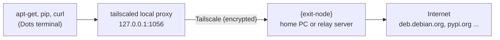

<h1 align="center">dots-tsnet</h1>

<p align="center"><a href="README.md">한국어</a> · English</p>

dots-tsnet makes downloads in a ChatGPT Dots cloud computer terminal (`apt-get install`, `pip install`, `curl`, git over HTTPS) leave through **your own home PC or relay server** instead of the platform proxy. As a bonus, `apt-get install` works without root.

Running Tailscale and SSH on the Dots computer is handled by [abruption/dots-tailscale](https://github.com/abruption/dots-tailscale), which this project uses unmodified as a pinned submodule. dots-tsnet adds two things on top: which way your downloads go out, and where packages get installed.

> This is a personal project. It is not affiliated with OpenAI, Tailscale, or dots-tailscale, and it may stop working if the Dots environment changes. Command-line messages are currently in Korean; this README and the docs are in English.

## Contents

- [Why you might need this](#why-you-might-need-this)
- [What you need, and what `{exit-node}` means](#what-you-need-and-what-exit-node-means)
- [Install](#install)
- [Everyday commands](#everyday-commands)
- [Speed](#speed)
- [Settings](#settings)
- [Reaching your tailnet without an exit node](#reaching-your-tailnet-without-an-exit-node)
- [After the VM is replaced](#after-the-vm-is-replaced)
- [FAQ](#faq)
- [Troubleshooting](#troubleshooting)
- [Uninstall](#uninstall)

## Why you might need this

The first `apt-get update` in a Dots terminal usually fails like this:

```text
W: Unable to read /etc/apt/apt.conf.d/80-applied-apt-retries - open (13: Permission denied)
E: List directory /var/lib/apt/lists/partial is missing. - Acquire (2: No such file or directory)
```

There are three reasons:

1. **No sudo.** You work as a regular user (uid 1000).
2. **System directories are read-only.** `/usr`, `/etc` and `/var` cannot be written, and `/var/lib/dpkg`, where apt records installed packages, does not exist.
3. **No direct internet access.** Traffic must go through the platform's HTTPS proxy (`browser-proxy:8889`), which inspects HTTPS.

With dots-tsnet installed, downloads go out like this:



- **Use apt as usual.** Typing `apt`, `apt-get` or `apt-cache` runs [tsapt](docs/tsapt.md), which downloads packages with their dependencies and installs them into `/workspace/.tsnet/root`. Since there is no sudo, `sudo apt install ...` is accepted too. These are PATH entries, not shell aliases, so they also work inside scripts.
- **Downloads leave through your device.** New shells get `http_proxy` and `https_proxy`, so pip, curl, git and npm go out through `{exit-node}`. To the outside world, requests come from `{exit-node}`'s public IP.
- **Install once.** Settings and installed packages live in `/workspace` and survive VM replacement.

For the details (the exact tailscaled command, what the Python shim does, and the network limits we measured), see [How it works](docs/how-it-works.md).

## What you need, and what `{exit-node}` means

| You need | Notes |
|---|---|
| A Tailscale account | The free plan is enough |
| A Dots cloud computer | The installer sets up dots-tailscale if it is missing |
| One `{exit-node}` device | A **home PC or relay server** that your downloads go out through |

Wherever these docs say `{exit-node}`, put that device's **Tailscale machine name**. It is the second column of `tailscale status` on any of your devices, and the same name appears on the [Machines page](https://console.tailscale.com/admin/machines) of the admin console. For example, if your home PC is called `home-pc`, write `--exit-node home-pc`.

Which device to pick:

- **Home PC**: the quickest way to start. If it shuts down or goes to sleep, downloads on Dots stop too.
- **Relay server**: an always-on device such as a NAS, a router or firewall (OPNsense and the like), or a small cloud VM. Recommended for long-term use.

If you prepare both, you can switch with `tsnet exit-node {another-device}` whenever one is down.

## Install

### Step 1: Prepare `{exit-node}`

Follow [Preparing an exit node](docs/exit-node.md) to turn on the exit node feature on your home PC or relay server and approve it in the Tailscale admin console. It usually takes about five minutes.

### Step 2: Download in the Dots terminal

Run this in the Dots desktop terminal (recommended) or over SSH. The Dots terminal cannot reach GitHub directly, so this one time you point git at the platform proxy.

```bash
cd /workspace
HTTPS_PROXY=http://browser-proxy:8889 HTTP_PROXY=http://browser-proxy:8889 \
  git clone --recurse-submodules https://github.com/hostkimjang/dots-tsnet.git
cd dots-tsnet
```

### Step 3: Run the installer

Replace `{exit-node}` with the device name from step 1.

```bash
bash install.sh --exit-node {exit-node}
```

The installer goes through these steps and skips anything already done:

1. **Install dots-tailscale and log in**: if it is missing, the pinned version (v0.4.0) is verified against SHA-256 values and installed. On first use, a Tailscale login URL appears; open it in your browser and approve. To SSH in from your own computer, add your public key (one `ssh-ed25519 AAAA...` line) with `--authorized-key '{ssh-public-key}'`.
2. **Install dots-tsnet**: `tsnet`, `tsapt` and the shell environment file go into `/workspace/.tsnet` and are hooked into `~/.bashrc`.
3. **Select the exit node**: Tailscale on Dots is told to use `{exit-node}`.
4. **Open the local proxies**: tailscaled is restarted with a SOCKS5 proxy (`127.0.0.1:1055`) and an HTTP proxy (`127.0.0.1:1056`).

> **Installing over SSH?** Step 4 restarts tailscaled, so your SSH session drops for a few seconds. Answer `y` when asked, or pass `--detach`, and the restart runs outside your SSH session with automatic rollback on failure. Just reconnect afterwards. Running the installer in the Dots desktop terminal avoids this entirely.

### Step 4: Check

Open a new shell (or run `source ~/.bashrc`) and look at the status:

```bash
tsnet status
```

A healthy setup looks like this (labels are in Korean):

```text
[exit node]
  {exit-node} 100.x.y.z online=True / 경로: DERP 릴레이 tok
[로컬 프록시]
  설정: {'http_port': 1056, 'socks_port': 1055} / 실행 중: {'http_port': 1056, 'socks_port': 1055} / 재시작 필요: False
[tailscaled]
  PID 1234 / TS_ 환경변수: 없음
[셸 연결]
  apt 연결: 켜짐 / sudo 대체: 켜짐 / 새 셸 자동 프록시: 켜짐
  지금 셸의 apt-get: /workspace/.tsnet/shims/apt-get
[외부로 보이는 IP]
  프록시 경유: 203.0.113.10
```

The sections are: exit node and its connection path, local proxies, tailscaled's PID and extra `TS_` variables, shell hooks, and the public IP seen through the proxy. If that last IP matches `{exit-node}`'s public IP, downloads are going out through it. Now try installing a package:

```bash
apt-get update
apt-get install -y pv
pv --version
```

## Everyday commands

| What you want | Command |
|---|---|
| See the current state | `tsnet status` |
| Refresh package lists | `apt-get update` or `apt update` |
| Install a package | `apt-get install -y {package}` (prefixing `sudo` is fine) |
| Upgrade packages installed by tsapt | `apt upgrade` |
| Remove a package | `apt remove {package}` |
| List packages installed by tsapt | `tsapt list` |
| List available exit nodes | `tsnet exit-node` |
| Switch or clear the exit node | `tsnet exit-node {exit-node}`, `tsnet exit-node off` |
| Turn the proxy off or on in this shell only | `tsnet_off`, `tsnet_on` |
| Run one command through the proxy from a shell where it is off | `tsnet run {command}` |
| Bring Tailscale back after a VM replacement | `tsnet start` |

## Speed

On Dots, Tailscale never gets a direct (peer-to-peer) connection, so all traffic is relayed through Tailscale's DERP servers. Expect a few hundred kB/s. These numbers come from downloading the same 7 MB file on 2026-10-23 through two `{exit-node}` devices in South Korea (a Windows PC and an OPNsense firewall):

| Path | Speed | Time for 7 MB |
|---|---|---|
| Through `{exit-node}`, one connection | 270–390 kB/s | 18–26 s |
| Through `{exit-node}`, four parallel connections | about 620 kB/s | 11 s |
| Platform proxy (`browser-proxy`) directly | about 18 MB/s | 0.4 s |

Why direct connections fail is explained in [How it works](docs/how-it-works.md#why-traffic-is-always-relayed-and-how-fast-it-is).

**Want fast apt downloads?** Set `TSNET_APT_PROXY=http://browser-proxy:8889` in `/workspace/.tsnet/tsnet.conf`. Only apt then uses the platform proxy; pip, curl and the rest still go through `{exit-node}`. The trade-off is that the platform proxy inspects HTTPS, so the platform can see which packages you download. apt verifies package GPG signatures, so tampered packages would be rejected at install time.

## Settings

The settings file is `/workspace/.tsnet/tsnet.conf`, in `NAME=value` form. An environment variable with the same name takes precedence.

| Setting | Default | Meaning |
|---|---|---|
| `TSNET_EXIT_NODE` | empty | Exit node to use. `tsnet exit-node` updates it |
| `TSNET_SOCKS_PORT`, `TSNET_HTTP_PORT` | `1055`, `1056` | Local proxy ports. Run `tsnet apply` after changing |
| `TSNET_AUTO_PROXY` | `1` | Set `http(s)_proxy` automatically in new shells |
| `TSNET_APT_SHIM` | `1` | Route `apt`, `apt-get`, `apt-cache` to tsapt |
| `TSNET_SUDO_SHIM` | `1` | When sudo is missing, route `sudo apt ...` to tsapt |
| `TSNET_PYTHONPATH` | `1` | Add `python3-*` modules installed by tsapt to `PYTHONPATH` |
| `TSNET_APT_SOURCES` | `official` | `official` uses official mirrors such as deb.debian.org; `system` copies the image's sources |
| `TSNET_APT_PROXY` | empty | Proxy for apt only. Empty means the tailscaled HTTP proxy; `off` means direct |
| `TSNET_NO_PROXY` | `localhost,127.0.0.1,::1,browser-proxy` | Addresses that skip the proxy |
| `TSNET_TAILSCALED_ENV` | empty | `TS_NAME=value` items added when tailscaled is freshly started, for example to turn off GSO/GRO. See [How it works](docs/how-it-works.md#tailscale-udp-gsogro-switches) |

## Reaching your tailnet without an exit node

An exit node only decides how traffic reaches the **internet**. Traffic between Dots and your own tailnet devices does not need one.

- **SSH from your computer into Dots**: `ssh agent@dots-sandbox` (dots-tailscale's default machine name)
- **From Dots to your tailnet devices**: Dots's tailscaled runs without a TUN device, so programs go through the local proxies:

```bash
curl -x http://127.0.0.1:1056 http://{tailnet-host}:{port}/
curl --socks5-hostname 127.0.0.1:1055 http://{tailnet-host}:{port}/
ssh -F /dev/null -o ProxyCommand="/workspace/.dots-tailscale/dots-ts cli nc %h %p" {user}${tailnet-host}
```

`{tailnet-host}` is the machine name or `100.x.y.z` address of the tailnet device you want to reach. More in [How it works](docs/how-it-works.md#reaching-your-tailnet-without-an-exit-node).

## After the VM is replaced

If `/workspace` survived, your settings and packages are still there. Just bring Tailscale back up:

```bash
/workspace/.tsnet/bin/tsnet start          # starts Tailscale, SSH and the local proxies
/workspace/.tsnet/bin/tsnet install-hook   # only if HOME was reset and the apt hook is gone
```

`tsnet start` runs dots-tailscale's `start.sh` and passes along `TSNET_TAILSCALED_ENV`. If you don't use that setting, running `bash /workspace/.dots-tailscale/start.sh` directly is the same.

## FAQ

**Is this an officially supported setup?**
No. Neither OpenAI nor Tailscale documents running Tailscale on Dots. This is a workaround that runs Tailscale as a regular user and tunnels its connections through the platform's HTTPS proxy. It may break when the platform changes.

**Can Tailscale connect directly (peer-to-peer)?**
Not today. Outbound UDP from Dots is filtered by destination, so Tailscale cannot build a direct path and always relays through DERP. Opening firewall ports on `{exit-node}` does not change this.

**Can the platform see my Tailscale traffic?**
tailscaled's connections pass through the platform proxy, which terminates TLS. The platform can see that you connect to Tailscale's servers (control plane, DERP) and the HTTP headers. It cannot read what is inside: the control protocol is encrypted with Noise, and tailnet packets are WireGuard-encrypted end to end. Once traffic leaves `{exit-node}` for the internet, it looks like traffic from that device.

**Should I turn off Tailscale's UDP GSO/GRO?**
It makes no speed difference on Dots. If you want them off anyway, use `TSNET_TAILSCALED_ENV` instead of editing dots-tailscale's files. The reasons and steps are in [How it works](docs/how-it-works.md#tailscale-udp-gsogro-switches).

## Troubleshooting

| Symptom | Cause and fix |
|---|---|
| `tsapt: 프록시 http://127.0.0.1:1056 에 연결할 수 없습니다` ("cannot connect to the proxy") | tailscaled stopped or the local proxy is closed. Check `tsnet status`; run `tsnet start` if tailscaled is gone, or `tsnet apply` if only the proxy is closed |
| Public IP check fails or times out | `{exit-node}` is off or not approved in the admin console. List candidates with `tsnet exit-node`; use `tsnet_off` to bypass the proxy for now |
| `apt-get` still points to `/usr/local/bin/apt-get` | This shell did not load the dots-tsnet environment. Run `source ~/.bashrc`, or `/workspace/.tsnet/bin/tsnet install-hook` |
| An installed program cannot find its data files | tsapt unpacks files elsewhere and does not run install scripts. See [tsapt limits](docs/tsapt.md#limits) |
| `dots-ts doctor` says `unhealthy` with `source integrity: mismatch` | A dots-tailscale file such as `setup.sh` was edited by hand. See [GSO/GRO switches](docs/how-it-works.md#tailscale-udp-gsogro-switches) |
| `ssh` on Dots fails with `Bad owner or permissions on /etc/ssh/ssh_config.d/...` | A permission problem in the Dots image's system SSH config. Skip it with `ssh -F /dev/null ...` |

## Uninstall

```bash
cd /workspace/dots-tsnet
bash uninstall.sh                  # removes everything, including installed packages
bash uninstall.sh --keep-packages  # keeps installed packages and the apt cache
```

dots-tailscale and your Tailscale login are left alone. To stop advertising the exit node, run `tailscale set --advertise-exit-node=false` on that device.

## Further reading

- [How it works](docs/how-it-works.md): the tailscaled command, the Python shim, network limits, GSO/GRO
- [Preparing an exit node](docs/exit-node.md): home PC or relay server
- [tsapt](docs/tsapt.md): how apt works without root, and its limits
- [Verification checklist](docs/CHECKLIST.md) (Korean), [Changelog](CHANGELOG.md) (Korean)

## Tested on

2026-10-22 and 23, on a Dots cloud computer (Debian 13 trixie, x86_64) with dots-tailscale v0.4.0 (Tailscale 1.102.4). Two kinds of `{exit-node}` were tested: a Windows 11 PC (Tailscale 1.102.2) and an OPNsense firewall (FreeBSD 14.3, Tailscale 1.92.2).

## License

MIT. dots-tailscale (MIT, abruption and contributors) is linked unmodified as the `upstream/dots-tailscale` submodule. See [THIRD_PARTY_NOTICES.md](THIRD_PARTY_NOTICES.md).
