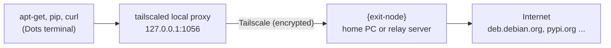

<h1 align="center">dots-tsnet</h1>

<p align="center"><a href="README.md">한국어</a> · English</p>

dots-tsnet makes downloads in a ChatGPT Dots cloud computer terminal (`apt-get install`, `pip install`, `curl`, git over HTTPS) leave through **your own home PC or relay server** instead of the platform proxy. As a bonus, `apt-get install` works without root.

Running Tailscale and SSH on the Dots computer is handled by [abruption/dots-tailscale](https://github.com/abruption/dots-tailscale), which this project uses unmodified as a pinned submodule. dots-tsnet adds two things on top: which way your downloads go out, and where packages get installed. It installs into `/workspace/shared` so that the setup survives Dots's own storage cleanup.

> This is a personal project. It is not affiliated with OpenAI, Tailscale, or dots-tailscale, and it may stop working if the Dots environment changes. Command-line messages are currently in Korean; this README and the docs are in English.

## Contents

- [Why you might need this](#why-you-might-need-this)
- [What you need, and what `{exit-node}` means](#what-you-need-and-what-exit-node-means)
- [Install](#install)
- [Everyday commands](#everyday-commands)
- [Where things live, and backups](#where-things-live-and-backups)
- [Speed](#speed)
- [Settings](#settings)
- [Reaching your tailnet without an exit node](#reaching-your-tailnet-without-an-exit-node)
- [After a VM replacement or a wiped install](#after-a-vm-replacement-or-a-wiped-install)
- [FAQ](#faq)
- [Troubleshooting](#troubleshooting)
- [Uninstall](#uninstall)

## Why you might need this

The first `apt-get update` in a Dots terminal usually fails like this:

```text
W: Unable to read /etc/apt/apt.conf.d/80-applied-apt-retries - open (13: Permission denied)
E: List directory /var/lib/apt/lists/partial is missing. - Acquire (2: No such file or directory)
```

There are three reasons:

1. **No sudo.** You work as a regular user (uid 1000).
2. **System directories are read-only.** `/usr`, `/etc` and `/var` cannot be written, and `/var/lib/dpkg`, where apt records installed packages, does not exist.
3. **No direct internet access.** Traffic must go through the platform's HTTPS proxy (`browser-proxy:8889`), which inspects HTTPS.

With dots-tsnet installed, downloads go out like this:



- **Use apt as usual.** Typing `apt`, `apt-get` or `apt-cache` runs [tsapt](docs/tsapt.md), which downloads packages with their dependencies and installs them into `/workspace/shared/.tsnet/root`. Since there is no sudo, `sudo apt install ...` is accepted too. These are PATH entries, not shell aliases, so they also work inside scripts.
- **Downloads leave through your device.** New shells get `http_proxy` and `https_proxy`, so pip, curl, git and npm go out through `{exit-node}`. To the outside world, requests come from `{exit-node}`'s public IP.
- **Install once.** Programs, settings and installed packages all live in `/workspace/shared` (`.tsnet`, `.dots-tailscale`). That folder survives the Dots scratch cleanup that deletes top-level folders under `/workspace`, and the Dots desktop keeps its own user settings there. See [Where things live, and backups](#where-things-live-and-backups).

For the details (the exact tailscaled command, what the Python shim does, the network limits we measured, and the cleanup we observed), see [How it works](docs/how-it-works.md).

## What you need, and what `{exit-node}` means

| You need | Notes |
|---|---|
| A Tailscale account | The free plan is enough |
| A Dots cloud computer | The installer sets up dots-tailscale if it is missing |
| One `{exit-node}` device | A **home PC or relay server** that your downloads go out through |

Wherever these docs say `{exit-node}`, put that device's **Tailscale machine name**. It is the second column of `tailscale status` on any of your devices, and the same name appears on the [Machines page](https://console.tailscale.com/admin/machines) of the admin console. For example, if your home PC is called `home-pc`, write `--exit-node home-pc`.

Which device to pick:

- **Home PC**: the quickest way to start. If it shuts down or goes to sleep, downloads on Dots stop too.
- **Relay server**: an always-on device such as a NAS, a router or firewall (OPNsense and the like), or a small cloud VM. Recommended for long-term use.

If you prepare both, you can switch with `tsnet exit-node {another-device}` whenever one is down.

## Install

### Step 1: Prepare `{exit-node}`

Follow [Preparing an exit node](docs/exit-node.md) to turn on the exit node feature on your home PC or relay server and approve it in the Tailscale admin console. It usually takes about five minutes.

### Step 2: Download in the Dots terminal

Run this in the Dots desktop terminal (recommended) or over SSH. The Dots terminal cannot reach GitHub directly, so this one time you point git at the platform proxy. The clone can live anywhere; the installer picks the install location.

```bash
cd ~
HTTPS_PROXY=http://browser-proxy:8889 HTTP_PROXY=http://browser-proxy:8889 \
  git clone --recurse-submodules https://github.com/hostkimjang/dots-tsnet.git
cd dots-tsnet
```

### Step 3: Run the installer

Replace `{exit-node}` with the device name from step 1.

```bash
bash install.sh --exit-node {exit-node}
```

The installer goes through these steps and skips anything already done:

1. **Install dots-tailscale and log in**: if it is missing, the pinned version (v0.4.0) is verified against SHA-256 values and installed into `/workspace/shared/.dots-tailscale`. On first use, a Tailscale login URL appears; open it in your browser and approve. To SSH in from your own computer, add your public key (one `ssh-ed25519 AAAA...` line) with `--authorized-key '{ssh-public-key}'`.
2. **Install dots-tsnet**: `tsnet`, `tsapt` and the shell environment file go into `/workspace/shared/.tsnet` and are hooked into `~/.bashrc`. A small library that keeps interactive SSH sessions from being dropped is compiled here too ([How it works](docs/how-it-works.md#interactive-ssh-pty-fix)).
3. **Select the exit node**: Tailscale on Dots is told to use `{exit-node}`.
4. **Open the local proxies**: tailscaled is restarted with a SOCKS5 proxy (`127.0.0.1:1055`) and an HTTP proxy (`127.0.0.1:1056`).

If an older version installed into your home directory (0.1.2) or into `/workspace` (0.1.1 or earlier), the same command moves that install into `/workspace/shared`. The Tailscale identity, SSH keys, settings and installed packages come along, so you do not log in again. If the moved install cannot start, the installer goes back to the old install. The move restarts tailscaled, which drops SSH for a minute or two, so add `--detach` when you run it over SSH.

> **Installing over SSH?** Step 4, and moving an older install, restart tailscaled, so your SSH session drops for a minute or two. Answer `y` when asked, or pass `--detach`, and the work continues outside your SSH session with automatic rollback on failure. A move is logged to `~/dots-tsnet-install.log`. Running the installer in the Dots desktop terminal avoids this entirely.

### Step 4: Check

Open a new shell (or run `source ~/.bashrc`) and look at the status:

```bash
tsnet status
```

A healthy setup looks like this (labels are in Korean):

```text
[exit node]
  {exit-node} 100.x.y.z online=True / 경로: DERP 릴레이 tok
[로컬 프록시]
  설정: {'http_port': 1056, 'socks_port': 1055} / 실행 중: {'http_port': 1056, 'socks_port': 1055} / 재시작 필요: False
[dots-tailscale]
  v0.4.0 / 파일 무결성: match
[tailscaled]
  PID 1234 / TS_ 환경변수: 없음
[설치 위치와 백업]
  설치: /workspace/shared/.tsnet, /workspace/shared/.dots-tailscale
  백업: /home/agent/.local/state/dots-tsnet / Tailscale 상태 2026-10-23 19:18 기준
[셸 연결]
  apt 연결: 켜짐 / sudo 대체: 켜짐 / 새 셸 자동 프록시: 켜짐
  지금 셸의 apt-get: /workspace/shared/.tsnet/shims/apt-get
[외부로 보이는 IP]
  프록시 경유: 203.0.113.10
```

The sections are: exit node and its connection path, local proxies, dots-tailscale version and file integrity, tailscaled's PID and extra `TS_` variables, install and backup locations, shell hooks, and the public IP seen through the proxy. If that last IP matches `{exit-node}`'s public IP, downloads are going out through it. Now try installing a package:

```bash
apt-get update
apt-get install -y pv
pv --version
```

## Everyday commands

| What you want | Command |
|---|---|
| See the current state | `tsnet status` |
| Refresh package lists | `apt-get update` or `apt update` |
| Install a package | `apt-get install -y {package}` (prefixing `sudo` is fine) |
| Upgrade packages installed by tsapt | `apt upgrade` |
| Remove a package | `apt remove {package}` |
| List packages installed by tsapt | `tsapt list` |
| List available exit nodes | `tsnet exit-node` |
| Switch or clear the exit node | `tsnet exit-node {exit-node}`, `tsnet exit-node off` |
| Turn the proxy off or on in this shell only | `tsnet_off`, `tsnet_on` |
| Run one command through the proxy from a shell where it is off | `tsnet run {command}` |
| Check dots-tailscale | `tsnet doctor` (`tsnet doctor --fix` if you edited dots-tailscale's files by hand) |
| Apply `TSNET_TAILSCALED_ENV` right away | `tsnet restart` (`tsnet restart --detach` over SSH) |
| Bring Tailscale back after a VM replacement | `tsnet start` |

## Where things live, and backups

| What | Where |
|---|---|
| dots-tailscale (Tailscale, sshd, node identity) | `/workspace/shared/.dots-tailscale` |
| dots-tsnet (tsnet, tsapt, settings, installed packages) | `/workspace/shared/.tsnet` |
| Identity backup | `~/.local/state/dots-tsnet` |
| Runtime sockets and logs | `/tmp/dots-tailscale-1000` |

Where `/workspace/shared` does not exist, dots-tsnet installs into the home directory (`~/.tsnet`, `~/.dots-tailscale`) and keeps the backup in `/workspace/shared/.dots-tsnet-backup`.

**Why `/workspace/shared`?** On 2026-10-23 at 06:49, the Dots scratch cleanup deleted several top-level folders under `/workspace`. It left a `v1` record in `/workspace/.scratch-cleaning/<task id>`. `/workspace/.tsnet`, `/workspace/.dots-tailscale` and a clone of this repository were gone, while the Dots task folder `/workspace/scratch` and the home directory survived. In the same second, the same job created `/workspace/shared`, and the Dots desktop configuration (`/etc/orbit-os/config.toml`) says user overrides persist in `/workspace/shared/.orbit-os`. The home directory also survived this cleanup, but everything in it was created after the VM booted, so nothing shows it outlives a VM replacement. dots-tsnet therefore installs where Dots itself keeps data it means to persist. The observations are in [How it works](docs/how-it-works.md#dots-storage-and-install-location).

**Backups.** dots-tsnet copies the node identity (Tailscale state file), the SSH host key, `authorized_keys`, `tsnet.conf` and the list of installed packages to the other side, the home directory (`~/.local/state/dots-tsnet`). Changed files are copied whenever a new shell starts and whenever you run `tsnet start` or `tsnet status`. If either side is lost, `install.sh` restores from the other, and it also looks in the backup location older versions used (`/workspace/.dots-tsnet-backup`). The backup contains Tailscale private keys; never copy it to another machine.

**Keep your work outside Dots too.** The install and its backup sit on the same disk, so if the whole Dots environment goes back to an older snapshot, both can go back with it. Several people report recent work disappearing while older files remained ([openai/codex#52765](https://github.com/openai/codex/issues/52765)). dots-tsnet itself can be reinstalled from this repository, and a lost identity only means logging in again with `--new-identity`. Work you create on Dots is safer with a copy outside Dots, such as Google Drive or the ChatGPT Library. The Dots sandbox has no `/dev/fuse`, so Google Drive cannot be mounted, but `rclone copy` can copy to it on a schedule.

**Prefer another location?** Choose it at install time. With a home-directory install, the backup goes to `/workspace/shared/.dots-tsnet-backup`.

```bash
TSNET_DIR=~/.tsnet DOTS_TS_DIR=~/.dots-tailscale bash install.sh --exit-node {exit-node}
```

## Speed

On Dots, Tailscale never gets a direct (peer-to-peer) connection, so all traffic is relayed through Tailscale's DERP servers. Expect a few hundred kB/s, varying a lot with the time of day and the relay path at that moment. These numbers come from downloading the same 7 MB file on 2026-10-23 through `{exit-node}` devices in South Korea (a Windows PC and an OPNsense firewall):

| Path | When | Speed |
|---|---|---|
| Through `{exit-node}`, one connection | 3 a.m. | 340–720 kB/s |
| Through `{exit-node}`, one connection | 7–8 p.m. | 90–230 kB/s |
| Through `{exit-node}`, four parallel connections | early morning | about 620 kB/s combined |
| Platform proxy (`browser-proxy`) directly | early morning | about 18 MB/s |

Back-to-back downloads with identical settings differed by up to two times, and the first download after a tailscaled restart tended to be slow. Why direct connections fail is explained in [How it works](docs/how-it-works.md#why-traffic-is-always-relayed-and-how-fast-it-is).

**Want fast apt downloads?** Set `TSNET_APT_PROXY=http://browser-proxy:8889` in `/workspace/shared/.tsnet/tsnet.conf`. Only apt then uses the platform proxy; pip, curl and the rest still go through `{exit-node}`. The trade-off is that the platform proxy inspects HTTPS, so the platform can see which packages you download. apt verifies package GPG signatures, so tampered packages would be rejected at install time.

## Settings

The settings file is `/workspace/shared/.tsnet/tsnet.conf`, in `NAME=value` form. An environment variable with the same name takes precedence.

| Setting | Default | Meaning |
|---|---|---|
| `TSNET_EXIT_NODE` | empty | Exit node to use. `tsnet exit-node` updates it |
| `TSNET_SOCKS_PORT`, `TSNET_HTTP_PORT` | `1055`, `1056` | Local proxy ports. Run `tsnet apply` after changing |
| `TSNET_AUTO_PROXY` | `1` | Set `http(s)_proxy` automatically in new shells |
| `TSNET_APT_SHIM` | `1` | Route `apt`, `apt-get`, `apt-cache` to tsapt |
| `TSNET_SUDO_SHIM` | `1` | When sudo is missing, route `sudo apt ...` to tsapt |
| `TSNET_PYTHONPATH` | `1` | Add `python3-*` modules installed by tsapt to `PYTHONPATH` |
| `TSNET_APT_SOURCES` | `official` | `official` uses official mirrors such as deb.debian.org; `system` copies the image's sources |
| `TSNET_APT_PROXY` | empty | Proxy for apt only. Empty means the tailscaled HTTP proxy; `off` means direct |
| `TSNET_NO_PROXY` | `localhost,127.0.0.1,::1,browser-proxy` | Addresses that skip the proxy |
| `TSNET_TAILSCALED_ENV` | empty | `TS_NAME=value` items added when tailscaled is freshly started, for example to turn off GSO/GRO. Apply right away with `tsnet restart`. See [How it works](docs/how-it-works.md#tailscale-udp-gsogro-switches) |
| `TSNET_IDENTITY_BACKUP` | `1` | Back up the node identity, SSH host key and settings to the location opposite the install |
| `TSNET_SSH_PTY_FIX` | `1` | Interactive SSH (PTY) fix. Without it, terminal-app SSH sessions may drop right after login |

The install locations are chosen at install time with the environment variables `TSNET_DIR` (default `/workspace/shared/.tsnet`) and `DOTS_TS_DIR` (default `/workspace/shared/.dots-tailscale`); the backup location with `TSNET_BACKUP_DIR`. Without `/workspace/shared`, the defaults are in the home directory.

## Reaching your tailnet without an exit node

An exit node only decides how traffic reaches the **internet**. Traffic between Dots and your own tailnet devices does not need one.

- **SSH from your computer into Dots**: `ssh agent@dots-sandbox` (dots-tailscale's default machine name)
- **From Dots to your tailnet devices**: Dots's tailscaled runs without a TUN device, so programs go through the local proxies:

```bash
curl -x http://127.0.0.1:1056 http://{tailnet-host}:{port}/
curl --socks5-hostname 127.0.0.1:1055 http://{tailnet-host}:{port}/
ssh -F /dev/null -o ProxyCommand="/workspace/shared/.dots-tailscale/dots-ts cli nc %h %p" {user}@{tailnet-host}
```

`{tailnet-host}` is the machine name or `100.x.y.z` address of the tailnet device you want to reach. More in [How it works](docs/how-it-works.md#reaching-your-tailnet-without-an-exit-node).

## After a VM replacement or a wiped install

**After a VM replacement.** If `/workspace` survived, your settings and packages are still there. Just bring Tailscale back up, and recreate the `~/.bashrc` hook if the home directory was reset:

```bash
/workspace/shared/.tsnet/bin/tsnet start          # starts Tailscale, SSH and the local proxies
/workspace/shared/.tsnet/bin/tsnet install-hook   # only if the ~/.bashrc hook is gone
```

`tsnet start` runs dots-tailscale's `start.sh` and passes along `TSNET_TAILSCALED_ENV` and the interactive SSH fix.

**If the install folders were wiped.** If `tsnet` is suddenly not found, or Chrome and apt start failing with `ERR_TUNNEL_CONNECTION_FAILED` or proxy errors, the install folders may have been deleted. Clone the repository again and run the installer:

```bash
cd ~
HTTPS_PROXY=http://browser-proxy:8889 HTTP_PROXY=http://browser-proxy:8889 \
  git clone --recurse-submodules https://github.com/hostkimjang/dots-tsnet.git
cd dots-tsnet && bash install.sh
```

The installer then:

- stops the old tailscaled, shim and sshd that are still running from deleted files, because they hold the ports and the socket that a new start needs;
- restores the node identity, SSH host key and `tsnet.conf` from the backup, so the machine comes back with the same name and the same exit node setting;
- lists the packages that were lost with the install and prints the command to reinstall them.

Without a backup, the old identity cannot come back. Run `bash install.sh --new-identity` to log in as a new machine, then delete the old machine in the admin console or rename the new one.

## FAQ

**Is this an officially supported setup?**
No. Neither OpenAI nor Tailscale documents running Tailscale on Dots. This is a workaround that runs Tailscale as a regular user and tunnels its connections through the platform's HTTPS proxy. It may break when the platform changes.

**Can Tailscale connect directly (peer-to-peer)?**
Not today. In our tests, UDP from Dots only got out to destination port 3478 (STUN). Tailscale peers normally listen on 41641 or a random port, so no direct path forms and traffic always goes through DERP. Making `{exit-node}` listen on UDP 3478 might allow a direct path, but we have not tested it.

**Can the platform see my Tailscale traffic?**
tailscaled's connections pass through the platform proxy, which terminates TLS. The platform can see that you connect to Tailscale's servers (control plane, DERP) and the HTTP headers. It cannot read what is inside: the control protocol is encrypted with Noise, and tailnet packets are WireGuard-encrypted end to end. Once traffic leaves `{exit-node}` for the internet, it looks like traffic from that device.

**Does turning off Tailscale's UDP GSO/GRO make it faster?**
It depends on the environment. These switches turn off offloads on the UDP socket that Tailscale uses for direct connections. Where GSO misbehaves, such as some kernel TUN setups, kernels or NICs, turning it off can help a lot: in [tailscale#20858](https://github.com/tailscale/tailscale/issues/20858), about 20 KiB/s became 14–20 MB/s. On Dots, all traffic goes through DERP over TCP, which these switches do not touch. On 2026-10-23 we alternated them off and on: off gave 117–124 kB/s and on gave 189 kB/s. The on phase also had a lower round-trip time (192 ms against 308–318 ms), which explains the difference. If you want them off anyway, use `TSNET_TAILSCALED_ENV` instead of editing dots-tailscale's files. The measurements and steps are in [How it works](docs/how-it-works.md#tailscale-udp-gsogro-switches).

## Troubleshooting

| Symptom | Cause and fix |
|---|---|
| `tsapt: 프록시 http://127.0.0.1:1056 에 연결할 수 없습니다` ("cannot connect to the proxy") | tailscaled stopped or the local proxy is closed. Check `tsnet status`; run `tsnet start` if tailscaled is gone, or `tsnet apply` if only the proxy is closed |
| Public IP check fails or times out | `{exit-node}` is off or not approved in the admin console. List candidates with `tsnet exit-node`; use `tsnet_off` to bypass the proxy for now |
| `tsnet` not found, or Chrome and apt suddenly fail with `ERR_TUNNEL_CONNECTION_FAILED` or proxy 500 errors | The install folders may have been deleted. Follow [After a VM replacement or a wiped install](#after-a-vm-replacement-or-a-wiped-install) |
| Start stops with `previously authenticated state is missing` | The node identity file is gone. With a backup, `tsnet start` or `install.sh` restores it automatically; without one, run `tsnet start --new-identity` |
| `apt-get` still points to `/usr/local/bin/apt-get` | This shell did not load the dots-tsnet environment. Run `source ~/.bashrc`, or `/workspace/shared/.tsnet/bin/tsnet install-hook` |
| An installed program cannot find its data files | tsapt unpacks files elsewhere and does not run install scripts. See [tsapt limits](docs/tsapt.md#limits) |
| `dots-ts doctor` says `unhealthy` with `source integrity: mismatch` | A dots-tailscale file such as `setup.sh` was edited by hand. `tsnet doctor --fix` moves any `TS_` settings you added into `tsnet.conf` and restores the original |
| Terminal-app SSH closes right away with `closed by remote host` (`ssh -T` works) | sshd fails to change the PTY's owner. Make sure `TSNET_SSH_PTY_FIX=1` (the default) and run `tsnet start`; sshd comes back with the fix |
| SSH refuses with `REMOTE HOST IDENTIFICATION HAS CHANGED` | The SSH host key changed during a reinstall. Check the fingerprint in the Dots desktop terminal with `ssh-keygen -lf /workspace/shared/.dots-tailscale/sshd/ssh_host_ed25519_key.pub`, then run `ssh-keygen -R {Dots machine name}` on your computer |
| `ssh` on Dots fails with `Bad owner or permissions on /etc/ssh/ssh_config.d/...` | A permission problem in the Dots image's system SSH config. Skip it with `ssh -F /dev/null ...` |

## Uninstall

```bash
cd ~/dots-tsnet
bash uninstall.sh                  # removes everything, including installed packages
bash uninstall.sh --keep-packages  # keeps installed packages and the apt cache
```

dots-tailscale, your Tailscale login and the backup (`~/.local/state/dots-tsnet`) are left alone. To stop advertising the exit node, run `tailscale set --advertise-exit-node=false` on that device.

## Further reading

- [How it works](docs/how-it-works.md): the tailscaled command, the Python shim, network limits, GSO/GRO, the workspace cleanup, the interactive SSH fix
- [Preparing an exit node](docs/exit-node.md): home PC or relay server
- [tsapt](docs/tsapt.md): how apt works without root, and its limits
- [Verification checklist](docs/CHECKLIST.md) (Korean), [Changelog](CHANGELOG.md) (Korean)

## Tested on

2026-10-22 to 24, on a Dots cloud computer (Debian 13 trixie, x86_64) with dots-tailscale v0.4.0 (Tailscale 1.102.4). Moving older installs (`/workspace` to the home directory, and the home directory to `/workspace/shared`) was also tested on a live Dots computer. Two kinds of `{exit-node}` were tested: a Windows 11 PC (Tailscale 1.102.2) and an OPNsense firewall (FreeBSD 14.3, Tailscale 1.92.2).

## License

MIT. dots-tailscale (MIT, abruption and contributors) is linked unmodified as the `upstream/dots-tailscale` submodule. See [THIRD_PARTY_NOTICES.md](THIRD_PARTY_NOTICES.md).
