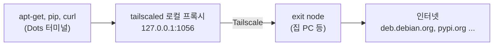

<h1 align="center">dots-tsnet</h1>

<p align="center">한국어 · <a href="README.en.md">English</a></p>

ChatGPT Dots 클라우드 컴퓨터에서 `apt-get install`, `pip install`, `curl` 같은 다운로드를 내 Tailscale exit node(예: 집 PC)로 내보내고, root 권한 없이도 apt 패키지를 설치할 수 있게 해 주는 도구입니다. Tailscale과 SSH 설치는 [abruption/dots-tailscale](https://github.com/abruption/dots-tailscale)을 그대로 쓰고, 그 위에 네트워크 경로와 패키지 설치 기능을 더합니다.

OpenAI, Tailscale, dots-tailscale의 공식 프로젝트가 아닌 개인 프로젝트입니다.

## 무엇이 바뀌나

Dots 컴퓨터의 터미널에서는 인터넷으로 직접 나가는 연결이 막혀 있고, 사용자 계정에 sudo가 없으며, 시스템 폴더와 dpkg 데이터베이스도 쓸 수 없습니다. 그래서 `apt-get update`는 권한 오류로, 대부분의 다운로드는 연결 오류로 실패합니다. dots-tsnet을 설치하면 다운로드가 아래 경로로 나갑니다.



- **apt 그대로 쓰기**: `apt`, `apt-get`, `apt-cache`를 입력하면 tsapt가 받아서 패키지를 `/workspace/.tsnet/root`에 설치합니다. sudo가 없는 컴퓨터에서는 `sudo apt ...`도 동작합니다. 셸 alias가 아니라 PATH 앞쪽의 연결이라 스크립트 안에서 호출해도 같습니다.
- **다른 도구도 같은 경로**: 새 셸에는 `http_proxy`, `https_proxy`가 잡혀 있어서 pip, curl, git(https), npm도 exit node로 나갑니다.
- **설정 유지**: 설정과 설치한 패키지는 `/workspace`에 있으므로 VM이 바뀌어도 남습니다.

## 준비물

- **Dots 클라우드 컴퓨터**: dots-tailscale이 없으면 설치 스크립트가 함께 설치합니다.
- **exit node로 쓸 기기 하나**: 집 PC, NAS, 클라우드 VM 등입니다. 설정 방법은 [exit node 준비](docs/exit-node.ko.md)에 있습니다.

## 설치

Dots 화면의 터미널(권장)이나 SSH에서 실행합니다. Dots 터미널은 GitHub에 직접 연결하지 못하므로 제공된 프록시를 지정해서 내려받습니다.

```bash
cd /workspace
HTTPS_PROXY=http://browser-proxy:8889 HTTP_PROXY=http://browser-proxy:8889 \
  git clone --recurse-submodules https://github.com/hostkimjang/dots-tsnet.git
cd dots-tsnet
bash install.sh --exit-node 내-PC-이름
```

설치 스크립트는 다음 순서로 진행합니다.

1. **dots-tailscale**: 없으면 고정된 버전(v0.4.0)을 SHA-256으로 확인한 뒤 설치하고, Tailscale 로그인 URL을 띄웁니다. SSH 공개키는 `--authorized-key '공개키'`로 같이 등록할 수 있습니다.
2. **dots-tsnet 파일**: `tsnet`, `tsapt`, 셸 환경 파일을 `/workspace/.tsnet`에 설치하고 `~/.bashrc`에 연결합니다.
3. **exit node**: `--exit-node`로 받은 기기를 지정합니다.
4. **로컬 프록시**: tailscaled를 SOCKS5(1055)와 HTTP(1056) 프록시와 함께 다시 시작합니다.

마지막 단계에서 tailscaled가 재시작되므로 SSH로 접속해 있었다면 연결이 몇 초 끊깁니다. SSH에서 실행할 때는 `--detach`를 붙이거나 물어볼 때 `y`를 입력하면, 재시작을 SSH 세션과 분리된 프로세스로 진행합니다. 새 데몬이 뜨지 않으면 dots-tailscale이 이전 데몬으로 되돌리고, 그래도 응답이 없으면 `start.sh`로 다시 띄웁니다. 원본 프로젝트는 이 단계를 Dots 화면의 터미널에서 하도록 권장하므로, 가능하면 그쪽에서 실행하세요.

설치가 끝나면 새 셸을 열고 확인합니다.

```bash
tsnet status
apt-get update
apt-get install -y pv && pv --version
```

## 사용법

| 명령 | 설명 |
|---|---|
| `tsnet status` | exit node, 로컬 프록시, 외부로 보이는 IP 확인 |
| `tsnet exit-node [이름\|off]` | exit node 목록 보기, 지정, 해제 |
| `tsnet apply [--detach]` | `tsnet.conf`의 포트로 프록시 다시 적용 |
| `tsnet run <명령>` | 프록시를 끈 셸에서 명령 하나만 프록시로 실행 |
| `apt-get update`, `apt update` | 패키지 목록 갱신 |
| `apt-get install -y <패키지>` | 의존성까지 받아 설치 |
| `apt upgrade` | tsapt로 설치한 패키지 갱신 |
| `apt remove <패키지>` | tsapt로 설치한 패키지 제거 |
| `tsapt list` | tsapt로 설치한 패키지 목록 |
| `tsnet_off`, `tsnet_on` | 현재 셸의 프록시 끄기, 켜기 |

## 설정

`/workspace/.tsnet/tsnet.conf`에서 바꿉니다. 같은 이름의 환경변수가 있으면 그 값이 먼저입니다.

| 키 | 기본값 | 설명 |
|---|---|---|
| `TSNET_EXIT_NODE` | 비어 있음 | 사용할 exit node. `tsnet exit-node`가 함께 바꿉니다 |
| `TSNET_SOCKS_PORT`, `TSNET_HTTP_PORT` | `1055`, `1056` | 로컬 프록시 포트. 바꾼 뒤 `tsnet apply` |
| `TSNET_AUTO_PROXY` | `1` | 새 셸에서 `http(s)_proxy` 자동 설정 |
| `TSNET_APT_SHIM` | `1` | `apt`, `apt-get`, `apt-cache`를 tsapt로 연결 |
| `TSNET_SUDO_SHIM` | `1` | sudo가 없을 때 `sudo apt ...`를 tsapt로 연결 |
| `TSNET_PYTHONPATH` | `1` | tsapt로 설치한 `python3-*` 모듈을 `PYTHONPATH`에 추가 |
| `TSNET_APT_SOURCES` | `official` | `official`은 deb.debian.org 같은 공식 저장소, `system`은 이미지 설정 복사 |
| `TSNET_APT_PROXY` | 비어 있음 | apt 전용 프록시. 비우면 tailscaled HTTP 프록시, `off`면 직접 연결 |
| `TSNET_NO_PROXY` | `localhost,127.0.0.1,::1,browser-proxy` | 프록시를 거치지 않을 주소 |

## tsapt의 동작과 한계

자세한 내용은 [tsapt 설명](docs/tsapt.ko.md)에 있습니다. 요약하면, 진짜 apt를 별도 설정으로 실행해 의존성을 계산하고 내려받은 뒤 `.deb`를 시스템 폴더 대신 `/workspace/.tsnet/root`에 풉니다. 시스템에 이미 있는 패키지는 다시 받지 않습니다. 설치 스크립트(postinst)는 실행하지 않으므로, 서비스 데몬이나 설치 과정에서 설정이 필요한 패키지는 동작하지 않을 수 있습니다.

## VM이 바뀌었을 때

`/workspace`가 남아 있으면 설정과 설치한 패키지도 그대로입니다.

```bash
bash /workspace/.dots-tailscale/start.sh      # Tailscale 과 로컬 프록시 기동
/workspace/.tsnet/bin/tsnet install-hook        # HOME 이 초기화됐다면 셸 연결 복구
```

## 제거

```bash
bash uninstall.sh                  # 설치한 패키지까지 모두 지움
bash uninstall.sh --keep-packages  # 설치한 패키지와 apt 캐시는 남김
```

dots-tailscale과 Tailscale 로그인 상태는 건드리지 않습니다.

## 알려진 제약

- **속도**: 트래픽이 Tailscale DERP 릴레이를 거치므로 수백 kB/s 수준입니다. 확인한 환경에서는 약 300kB/s였습니다.
- **exit node 전원**: exit node 기기가 꺼지면 다운로드가 실패합니다. `tsnet_off`로 잠시 끄거나 다른 exit node를 지정하세요.
- **적용 범위**: 셸에서 실행한 프로그램에만 적용됩니다. 브라우저, ChatGPT 커넥터, Dots 에이전트 자체의 네트워크는 바뀌지 않습니다.
- **exit node 공유**: exit node를 승인하면 접근 정책(ACL)이 허용하는 다른 tailnet 기기도 그 기기를 exit node로 쓸 수 있습니다.

## 검증한 환경

2026-10-22에 Dots 클라우드 컴퓨터(Debian 13 trixie, x86_64)와 dots-tailscale v0.4.0(Tailscale 1.102.4)에서 확인했습니다. exit node는 Windows 11(Tailscale 1.102.2)과 OPNsense(FreeBSD 14.3, Tailscale 1.92.2) 두 가지로 확인했습니다. 확인한 항목과 아직 확인하지 못한 항목은 [체크리스트](docs/CHECKLIST.md)에 있습니다.

## 라이선스

MIT입니다. dots-tailscale(MIT, abruption and contributors)은 `upstream/dots-tailscale` 서브모듈로 수정 없이 연결합니다. 자세한 내용은 [THIRD_PARTY_NOTICES.md](THIRD_PARTY_NOTICES.md)에 있습니다.
