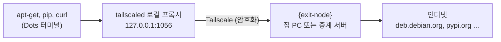

<h1 align="center">dots-tsnet</h1>

<p align="center">한국어 · <a href="README.en.md">English</a></p>

ChatGPT Dots 클라우드 컴퓨터의 터미널에서 `apt-get install`, `pip install`, `curl` 같은 다운로드가 **내 집 PC나 중계 서버를 거쳐** 인터넷으로 나가게 해 줍니다. 덤으로, root 권한이 없어도 `apt-get install`로 패키지를 설치할 수 있게 합니다.

Dots 컴퓨터에 Tailscale과 SSH를 올리는 부분은 [abruption/dots-tailscale](https://github.com/abruption/dots-tailscale)을 고치지 않고 그대로 씁니다. dots-tsnet은 그 위에 "다운로드가 어느 길로 나갈지"와 "패키지를 어디에 설치할지"를 더합니다.

> OpenAI, Tailscale, dots-tailscale의 공식 프로젝트가 아닌 개인 프로젝트입니다. Dots 환경이 바뀌면 동작하지 않을 수 있습니다.

## 목차

- [왜 필요한가요](#왜-필요한가요)
- [준비물과 `{exit-node}`](#준비물과-exit-node)
- [설치하기](#설치하기)
- [매일 쓰는 명령](#매일-쓰는-명령)
- [속도](#속도)
- [설정 바꾸기](#설정-바꾸기)
- [exit node 없이 tailnet 기기에 접속하기](#exit-node-없이-tailnet-기기에-접속하기)
- [VM이 바뀌었을 때](#vm이-바뀌었을-때)
- [자주 묻는 질문](#자주-묻는-질문)
- [문제 해결](#문제-해결)
- [제거하기](#제거하기)

## 왜 필요한가요

Dots 터미널에서 처음 `apt-get update`를 실행하면 대개 이렇게 실패합니다.

```text
W: Unable to read /etc/apt/apt.conf.d/80-applied-apt-retries - open (13: Permission denied)
E: List directory /var/lib/apt/lists/partial is missing. - Acquire (2: No such file or directory)
```

원인은 세 가지입니다.

1. **sudo가 없습니다.** 일반 사용자 계정(uid 1000)으로만 작업합니다.
2. **시스템 폴더에 쓸 수 없습니다.** `/usr`, `/etc`, `/var`는 쓰기가 막혀 있고, apt가 설치 기록을 남기는 `/var/lib/dpkg`도 아예 없습니다.
3. **인터넷으로 바로 나갈 수 없습니다.** 플랫폼이 주는 HTTPS 프록시(`browser-proxy:8889`)를 거쳐야 하고, 이 프록시는 HTTPS 내용을 열어 봅니다.

dots-tsnet을 설치하면 다운로드가 이렇게 나갑니다.



- **`apt`를 그대로 씁니다.** `apt`, `apt-get`, `apt-cache`를 입력하면 [tsapt](docs/tsapt.ko.md)가 받아서 의존성까지 내려받고 `/workspace/.tsnet/root`에 설치합니다. sudo가 없으니 `sudo apt install ...`도 같은 명령으로 처리합니다. 셸 alias가 아니라 PATH 앞쪽에 둔 연결이라 스크립트 안에서 불러도 똑같이 동작합니다.
- **다운로드가 내 기기를 거쳐 나갑니다.** 새 셸에는 `http_proxy`, `https_proxy`가 잡혀 있어서 pip, curl, git(https), npm도 `{exit-node}`를 거쳐 나갑니다. 밖에서 보면 `{exit-node}`의 공인 IP에서 온 요청입니다.
- **한 번만 설치하면 됩니다.** 설정과 설치한 패키지는 `/workspace`에 있어서 VM이 바뀌어도 남습니다.

어떻게 동작하는지 자세히 알고 싶다면 [동작 원리](docs/how-it-works.ko.md)를 보세요. tailscaled 실행 명령, Python shim이 하는 일, 측정한 네트워크 제약을 모두 정리해 두었습니다.

## 준비물과 `{exit-node}`

| 준비물 | 설명 |
|---|---|
| Tailscale 계정 | 무료 플랜으로 충분합니다 |
| Dots 클라우드 컴퓨터 | dots-tailscale이 없으면 설치 스크립트가 함께 설치합니다 |
| `{exit-node}` 기기 한 대 | 다운로드가 거쳐 나갈 **집 PC 또는 중계 서버** |

이 문서에서 `{exit-node}`라고 쓴 자리에는 그 기기의 **Tailscale 이름**을 넣습니다. 이름은 아무 기기에서나 `tailscale status`를 실행했을 때 두 번째 열에 나오는 값이고, [관리 콘솔의 Machines](https://console.tailscale.com/admin/machines) 화면에도 같은 이름이 보입니다. 예를 들어 집 PC 이름이 `home-pc`라면 `--exit-node home-pc`처럼 씁니다.

어떤 기기를 고를지 망설여진다면 이렇게 보면 됩니다.

- **집 PC**: 가장 빨리 시작할 수 있습니다. 다만 PC가 꺼지거나 절전 상태가 되면 Dots의 다운로드도 함께 멈춥니다.
- **중계 서버**: NAS, 공유기나 방화벽(OPNsense 등), 작은 클라우드 VM처럼 늘 켜져 있는 기기입니다. 오래 쓸 생각이라면 이쪽을 권합니다.

두 대를 모두 준비해 두면 하나가 꺼졌을 때 `tsnet exit-node {다른-기기}`로 바로 바꿀 수 있습니다.

## 설치하기

### 1단계: `{exit-node}` 준비

[exit node 준비하기](docs/exit-node.ko.md)를 따라 집 PC나 중계 서버에서 exit node를 켜고, Tailscale 관리 콘솔에서 승인합니다. 보통 5분이면 끝납니다.

### 2단계: Dots 터미널에서 내려받기

Dots 화면의 터미널(권장)이나 SSH 세션에서 실행합니다. Dots 터미널은 GitHub에 바로 연결하지 못하므로, 이번 한 번만 플랫폼 프록시를 지정해서 내려받습니다.

```bash
cd /workspace
HTTPS_PROXY=http://browser-proxy:8889 HTTP_PROXY=http://browser-proxy:8889 \
  git clone --recurse-submodules https://github.com/hostkimjang/dots-tsnet.git
cd dots-tsnet
```

### 3단계: 설치 스크립트 실행

`{exit-node}` 자리에 1단계에서 준비한 기기 이름을 넣습니다.

```bash
bash install.sh --exit-node {exit-node}
```

설치 스크립트는 아래 순서로 진행하고, 이미 끝난 단계는 건너뜁니다.

1. **dots-tailscale 설치와 로그인**: 없으면 고정된 버전(v0.4.0)을 SHA-256으로 확인한 뒤 설치합니다. 처음이라면 Tailscale 로그인 URL이 나오니 브라우저에서 열어 승인하세요. 내 PC에서 SSH로 들어오고 싶다면 `--authorized-key '{ssh-public-key}'`로 공개키(`ssh-ed25519 AAAA...` 한 줄)를 함께 등록합니다.
2. **dots-tsnet 설치**: `tsnet`, `tsapt`, 셸 환경 파일을 `/workspace/.tsnet`에 넣고 `~/.bashrc`에 연결합니다.
3. **exit node 지정**: Dots의 Tailscale이 `{exit-node}`로 나가도록 설정합니다.
4. **로컬 프록시 열기**: tailscaled를 SOCKS5(`127.0.0.1:1055`)와 HTTP(`127.0.0.1:1056`) 프록시와 함께 다시 시작합니다.

> **SSH로 접속해서 설치하는 경우**: 4번에서 tailscaled가 다시 시작되면서 SSH 연결이 몇 초 끊깁니다. 물어볼 때 `y`를 입력하거나 처음부터 `--detach`를 붙이면, 재시작을 SSH 세션과 분리해서 진행하고 실패하면 이전 상태로 되돌립니다. 끊기면 다시 접속하면 됩니다. Dots 화면의 터미널에서 실행하면 이런 걱정이 없습니다.

### 4단계: 확인

새 셸을 열거나 `source ~/.bashrc`를 실행한 다음 상태를 봅니다.

```bash
tsnet status
```

이런 모양이면 정상입니다.

```text
[exit node]
  {exit-node} 100.x.y.z online=True / 경로: DERP 릴레이 tok
[로컬 프록시]
  설정: {'http_port': 1056, 'socks_port': 1055} / 실행 중: {'http_port': 1056, 'socks_port': 1055} / 재시작 필요: False
[tailscaled]
  PID 1234 / TS_ 환경변수: 없음
[셸 연결]
  apt 연결: 켜짐 / sudo 대체: 켜짐 / 새 셸 자동 프록시: 켜짐
  지금 셸의 apt-get: /workspace/.tsnet/shims/apt-get
[외부로 보이는 IP]
  프록시 경유: 203.0.113.10
```

마지막 줄의 IP가 `{exit-node}`의 공인 IP와 같으면 다운로드가 그 기기를 거쳐 나가고 있는 것입니다. 이제 패키지를 하나 설치해 봅니다.

```bash
apt-get update
apt-get install -y pv
pv --version
```

## 매일 쓰는 명령

| 하고 싶은 일 | 명령 |
|---|---|
| 지금 상태 보기 | `tsnet status` |
| 패키지 목록 갱신 | `apt-get update` 또는 `apt update` |
| 패키지 설치 | `apt-get install -y {package}` (`sudo`를 붙여도 됩니다) |
| tsapt로 설치한 패키지 갱신 | `apt upgrade` |
| 패키지 제거 | `apt remove {package}` |
| tsapt로 설치한 패키지 목록 | `tsapt list` |
| 쓸 수 있는 exit node 목록 | `tsnet exit-node` |
| exit node 바꾸기, 끄기 | `tsnet exit-node {exit-node}`, `tsnet exit-node off` |
| 지금 셸에서만 프록시 끄기, 켜기 | `tsnet_off`, `tsnet_on` |
| 프록시를 끈 셸에서 명령 하나만 프록시로 | `tsnet run {command}` |
| VM이 바뀐 뒤 Tailscale 다시 띄우기 | `tsnet start` |

## 속도

Dots에서는 Tailscale 기기끼리 직접 연결(P2P)이 만들어지지 않아서, 모든 트래픽이 Tailscale의 DERP 중계 서버를 거칩니다. 그래서 다운로드는 수백 kB/s 수준입니다. 아래는 2026-10-23에 한국에 있는 `{exit-node}` 두 대(Windows PC, OPNsense)로 같은 7MB 파일을 받아 본 결과입니다.

| 경로 | 속도 | 7MB 받는 데 걸린 시간 |
|---|---|---|
| `{exit-node}` 경유, 연결 1개 | 270~390kB/s | 18~26초 |
| `{exit-node}` 경유, 연결 4개를 동시에 | 약 620kB/s | 11초 |
| 플랫폼 프록시(`browser-proxy`)로 바로 | 약 18MB/s | 0.4초 |

직접 연결이 안 되는 이유는 [동작 원리](docs/how-it-works.ko.md#항상-derp를-거치는-이유와-속도)에 정리했습니다.

**apt만 빠르게 받고 싶다면** `/workspace/.tsnet/tsnet.conf`에서 `TSNET_APT_PROXY=http://browser-proxy:8889`로 바꿉니다. apt 다운로드만 플랫폼 프록시로 나가고 pip, curl 등은 계속 `{exit-node}`를 거칩니다. 대신 플랫폼 프록시는 HTTPS 내용을 열어 보는 프록시라서 어떤 패키지를 받는지 플랫폼이 볼 수 있습니다. apt는 패키지의 GPG 서명을 확인하므로, 중간에 내용이 바뀌면 설치 단계에서 거부됩니다.

## 설정 바꾸기

설정 파일은 `/workspace/.tsnet/tsnet.conf`입니다. `이름=값` 형식이고, 같은 이름의 환경변수가 있으면 그 값이 먼저입니다.

| 설정 | 기본값 | 설명 |
|---|---|---|
| `TSNET_EXIT_NODE` | 비어 있음 | 쓸 exit node. `tsnet exit-node`가 함께 바꿉니다 |
| `TSNET_SOCKS_PORT`, `TSNET_HTTP_PORT` | `1055`, `1056` | 로컬 프록시 포트. 바꾼 뒤 `tsnet apply` |
| `TSNET_AUTO_PROXY` | `1` | 새 셸에서 `http(s)_proxy`를 자동으로 설정 |
| `TSNET_APT_SHIM` | `1` | `apt`, `apt-get`, `apt-cache`를 tsapt로 연결 |
| `TSNET_SUDO_SHIM` | `1` | sudo가 없을 때 `sudo apt ...`를 tsapt로 연결 |
| `TSNET_PYTHONPATH` | `1` | tsapt로 설치한 `python3-*` 모듈을 `PYTHONPATH`에 추가 |
| `TSNET_APT_SOURCES` | `official` | `official`은 deb.debian.org 같은 공식 저장소, `system`은 이미지의 저장소 설정을 복사 |
| `TSNET_APT_PROXY` | 비어 있음 | apt 전용 프록시. 비우면 tailscaled HTTP 프록시, `off`면 직접 연결 |
| `TSNET_NO_PROXY` | `localhost,127.0.0.1,::1,browser-proxy` | 프록시를 거치지 않을 주소 |
| `TSNET_TAILSCALED_ENV` | 비어 있음 | tailscaled를 새로 띄울 때 붙일 `TS_이름=값` 목록. GSO·GRO 끄기 같은 용도이며 [동작 원리](docs/how-it-works.ko.md#tailscale-udp-gsogro-설정)에 설명이 있습니다 |

## exit node 없이 tailnet 기기에 접속하기

exit node는 **인터넷**으로 나가는 길만 정합니다. Dots와 내 tailnet 기기 사이의 통신에는 exit node가 필요 없습니다.

- **내 PC에서 Dots로 SSH**: `ssh agent@dots-sandbox` (dots-tailscale 기본 이름 기준)
- **Dots에서 tailnet 기기로**: Dots의 tailscaled는 TUN 장치 없이 동작하기 때문에, 프로그램이 로컬 프록시를 거쳐야 합니다.

```bash
curl -x http://127.0.0.1:1056 http://{tailnet-host}:{port}/
curl --socks5-hostname 127.0.0.1:1055 http://{tailnet-host}:{port}/
ssh -F /dev/null -o ProxyCommand="/workspace/.dots-tailscale/dots-ts cli nc %h %p" {user}${tailnet-host}
```

`{tailnet-host}`에는 접속할 tailnet 기기의 이름이나 `100.x.y.z` 주소를 넣습니다. 자세한 내용은 [동작 원리](docs/how-it-works.ko.md#exit-node-없이-tailnet에-접속하기)를 보세요.

## VM이 바뀌었을 때

`/workspace`가 남아 있으면 설정과 설치한 패키지도 그대로입니다. Tailscale만 다시 띄우면 됩니다.

```bash
/workspace/.tsnet/bin/tsnet start          # Tailscale, SSH, 로컬 프록시 기동
/workspace/.tsnet/bin/tsnet install-hook   # HOME 이 초기화돼서 apt 연결이 사라졌을 때만
```

`tsnet start`는 dots-tailscale의 `start.sh`를 실행하면서 `TSNET_TAILSCALED_ENV`를 함께 넘깁니다. 이 설정을 쓰지 않는다면 `bash /workspace/.dots-tailscale/start.sh`를 직접 실행해도 같습니다.

## 자주 묻는 질문

**공식적으로 지원되는 방법인가요?**
아닙니다. OpenAI도 Tailscale도 Dots에서 Tailscale을 쓰는 방법을 안내하지 않습니다. 일반 사용자 권한으로 Tailscale을 띄우고, 그 연결을 플랫폼 HTTPS 프록시로 통과시키는 우회 방식입니다. 플랫폼이 바뀌면 동작하지 않을 수 있습니다.

**Tailscale 직접 연결(P2P)은 안 되나요?**
지금은 안 됩니다. Dots에서 밖으로 나가는 UDP가 목적지에 따라 막혀 있어서 Tailscale이 직접 연결을 만들지 못하고, 항상 DERP 중계 서버를 거칩니다. `{exit-node}`의 방화벽 포트를 열어도 결과는 같습니다.

**플랫폼이 내 Tailscale 트래픽을 볼 수 있나요?**
tailscaled의 연결은 플랫폼 프록시를 거치고, 이 프록시는 TLS를 풀어 봅니다. 그래서 플랫폼은 Tailscale 서버(controlplane, DERP)에 접속한다는 사실과 HTTP 헤더를 볼 수 있습니다. 하지만 그 안의 제어 통신(Noise 암호화)과 tailnet 패킷(WireGuard 암호화)은 종단 간 암호화돼 있어서 내용은 보이지 않습니다. `{exit-node}`에서 인터넷으로 나간 뒤의 트래픽은 그 기기에서 직접 접속한 것과 같습니다.

**Tailscale의 UDP GSO·GRO를 꺼야 하나요?**
Dots에서는 속도에 영향이 없습니다. 끄고 싶다면 dots-tailscale 파일을 고치지 말고 `TSNET_TAILSCALED_ENV`를 쓰세요. [동작 원리](docs/how-it-works.ko.md#tailscale-udp-gsogro-설정)에 이유와 방법을 정리했습니다.

## 문제 해결

| 증상 | 원인과 해결 |
|---|---|
| `tsapt: 프록시 http://127.0.0.1:1056 에 연결할 수 없습니다` | tailscaled가 꺼졌거나 로컬 프록시가 닫혔습니다. `tsnet status`로 확인하고, tailscaled가 없으면 `tsnet start`, 프록시만 닫혔으면 `tsnet apply` |
| 외부 IP 확인이 실패하거나 시간이 초과됨 | `{exit-node}`가 꺼졌거나 관리 콘솔에서 승인되지 않았습니다. `tsnet exit-node`로 목록을 보고, 급하면 `tsnet_off`로 잠시 프록시를 끕니다 |
| `apt-get`이 아직 `/usr/local/bin/apt-get`을 가리킴 | 이 셸이 dots-tsnet 환경을 불러오지 않았습니다. `source ~/.bashrc`, 그래도 안 되면 `/workspace/.tsnet/bin/tsnet install-hook` |
| 설치한 프로그램이 데이터 파일을 못 찾음 | tsapt는 설치 스크립트를 실행하지 않고 파일을 다른 위치에 풉니다. [tsapt의 한계](docs/tsapt.ko.md#한계)를 보세요 |
| `dots-ts doctor`가 `unhealthy`, `source integrity: mismatch` | dots-tailscale의 설치 파일(예: `setup.sh`)을 직접 고치면 나옵니다. [GSO·GRO 설정](docs/how-it-works.ko.md#tailscale-udp-gsogro-설정)을 보세요 |
| Dots에서 `ssh`가 `Bad owner or permissions on /etc/ssh/ssh_config.d/...`로 실패 | Dots 이미지의 시스템 SSH 설정 파일 권한 문제입니다. `ssh -F /dev/null ...`처럼 시스템 설정을 건너뜁니다 |

## 제거하기

```bash
cd /workspace/dots-tsnet
bash uninstall.sh                  # 설치한 패키지까지 모두 지움
bash uninstall.sh --keep-packages  # 설치한 패키지와 apt 캐시는 남김
```

dots-tailscale과 Tailscale 로그인 상태는 건드리지 않습니다. exit node 기기에서 광고를 끄려면 그 기기에서 `tailscale set --advertise-exit-node=false`를 실행합니다.

## 더 읽을 거리

- [동작 원리](docs/how-it-works.ko.md): tailscaled 실행 명령, Python shim, 네트워크 제약, GSO·GRO
- [exit node 준비하기](docs/exit-node.ko.md): 집 PC 또는 중계 서버 설정
- [tsapt 설명](docs/tsapt.ko.md): root 없이 apt가 동작하는 방식과 한계
- [검증 체크리스트](docs/CHECKLIST.md), [변경 기록](CHANGELOG.md)

## 검증한 환경

2026-10-22~23에 Dots 클라우드 컴퓨터(Debian 13 trixie, x86_64)와 dots-tailscale v0.4.0(Tailscale 1.102.4)에서 확인했습니다. `{exit-node}`는 Windows 11 PC(Tailscale 1.102.2)와 OPNsense 방화벽(FreeBSD 14.3, Tailscale 1.92.2) 두 가지로 시험했습니다.

## 라이선스

MIT입니다. dots-tailscale(MIT, abruption and contributors)은 `upstream/dots-tailscale` 서브모듈로 고치지 않고 연결합니다. 자세한 내용은 [THIRD_PARTY_NOTICES.md](THIRD_PARTY_NOTICES.md)에 있습니다.
