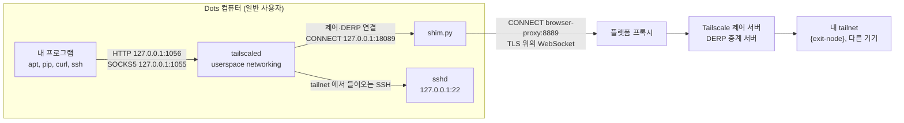

# 동작 원리

[English](how-it-works.md) · 한국어 · [README로 돌아가기](../README.md)

이 문서는 Dots 컴퓨터에서 실제로 무엇이 실행되는지, 각 부분이 왜 필요한지, 네트워크에서 무엇을 기대할 수 있고 무엇은 안 되는지를 설명합니다. 모든 내용은 2026-10-22~23에 실제 Dots 컴퓨터(Debian 13, x86_64, dots-tailscale v0.4.0, Tailscale 1.102.4)에서 확인했습니다. Dots는 Tailscale이 공식으로 안내하는 플랫폼이 아니므로, 보장이 아니라 관찰 결과로 읽어 주세요.

## 짧은 답

- **Dots를 tailnet에 붙이는 공식 방법이 있나요?** 없습니다. OpenAI도 Tailscale도 안내하지 않습니다. 이 구성은 Tailscale을 일반 사용자 권한의 userspace networking 모드로 띄우고, 그 연결을 플랫폼 HTTPS 프록시로 통과시킵니다.
- **tailnet에 접속하려면 exit node가 필요한가요?** 아닙니다. Dots로 SSH 접속하거나 Dots에서 내 다른 기기로 접속하는 데는 필요 없습니다. exit node는 Dots의 인터넷 다운로드를 내 네트워크로 내보내고 싶을 때만 필요합니다.
- **직접 연결(P2P)인가요?** 아닙니다. Dots에서 나가는 UDP는 목적지 포트가 3478일 때만 통과하는 것으로 보이고, Tailscale 기기는 다른 포트에서 기다리기 때문에 직접 연결이 만들어지지 않습니다. 모든 트래픽이 Tailscale의 DERP 중계 서버를 거치고, 연결 하나당 속도는 수백 kB/s 수준입니다.
- **실행 명령에 키가 들어가나요?** 아닙니다. 처음에 `tailscale up`으로 한 번 로그인하고(로그인 URL 또는 auth key 파일), 기기 신원은 상태 디렉터리에 저장됩니다.
- **어디에 설치되나요?** 홈 폴더(`~/.dots-tailscale`, `~/.tsnet`)입니다. Dots의 정리 작업이 `/workspace` 최상위 폴더를 지운 일이 있어서입니다. 아래 [Dots 정리 작업과 설치 위치](#dots-정리-작업과-설치-위치)에 기록했습니다.

## Dots 터미널에서 닿는 곳

| Dots 터미널에서 시험한 것 | 결과 |
|---|---|
| 인터넷으로 바로 HTTPS 연결 | 연결 실패 (curl 종료 코드 7) |
| `http://browser-proxy:8889`를 거친 HTTPS | 동작. 프록시가 이미지가 신뢰하는 CA로 TLS를 풀어서 다시 맺음 |
| Tailscale DERP 28개 지역의 STUN(UDP 3478), Tailscale 클라이언트와 같은 형식의 요청 | 모든 지역이 응답 |
| 같은 DERP 지역에 일반 STUN 요청 | 응답 없음 |
| Google STUN, UDP 3478과 19302 | 3478만 응답(세 번 중 세 번), 19302는 응답 없음 |
| Cloudflare STUN, UDP 3478, 53, 443 | 3478만 응답 |
| DNS(UDP 53: 8.8.8.8, 1.1.1.1, 9.9.9.9, OpenDNS), NTP(UDP 123) | 응답 없음 |
| `tailscale netcheck` | `UDP: true`, `MappingVariesByDestIP: true` |
| tailnet 기기와 `tailscale ping` (양쪽 방향) | 항상 "via DERP", "direct connection not established" |
| sudo, `/usr`·`/etc`·`/var` 쓰기 | 불가 |

나가는 UDP는 목적지 포트가 3478일 때만 통과하는 것으로 보입니다. 시험한 포트는 53, 123, 443, 3478, 19302뿐이라 다른 포트는 알 수 없습니다. DERP 지역에 처음 보낸 일반 STUN 요청이 응답을 받지 못해 한때 "UDP가 막혀 있다"고 적었는데, Tailscale 클라이언트와 같은 형식으로 다시 보내니 모든 지역이 응답했습니다. 우리가 볼 수 있는 것은 결과뿐이고, 플랫폼의 실제 정책은 알 수 없습니다.

## 구성 요소



| 프로세스 | 듣는 주소 | 역할 |
|---|---|---|
| `tailscaled` | `127.0.0.1:1055`(SOCKS5), `127.0.0.1:1056`(HTTP). 둘 다 dots-tsnet이 켬 | Tailscale 노드. TUN 장치 없이 프로세스 안에 자체 TCP/IP 스택을 둠 |
| `shim.py` | `127.0.0.1:18089` | Tailscale의 제어·DERP 연결이 플랫폼 프록시를 통과하게 함 |
| `sshd` (사용자 권한) | `127.0.0.1:22` | tailnet을 통해 Dots로 SSH 접속. dots-tsnet이 대화형 SSH 보정을 붙임 |
| `browser-proxy` (플랫폼) | `browser-proxy:8889` | 인터넷으로 나가는 유일한 길 |

## tailscaled 실행 명령

dots-tailscale v0.4.0이 실행하는 명령에, 마지막 두 프록시 옵션을 dots-tsnet이 더한 것입니다. 경로는 기본 설치 위치(`/home/agent/.dots-tailscale`) 기준이고, 키는 들어 있지 않습니다.

```bash
HTTPS_PROXY=http://127.0.0.1:18089 \
HTTP_PROXY=http://127.0.0.1:18089 \
SSL_CERT_FILE=/home/agent/.dots-tailscale/shim/bundle.crt \
/home/agent/.dots-tailscale/tailscaled \
  --tun=userspace-networking \
  --statedir=/home/agent/.dots-tailscale/state \
  --socket=/tmp/dots-tailscale-1000/tailscaled.sock \
  --port=0 \
  --socks5-server=127.0.0.1:1055 \
  --outbound-http-proxy-listen=127.0.0.1:1056
```

각 부분의 역할은 이렇습니다.

- `HTTPS_PROXY`, `HTTP_PROXY`: tailscaled 자신의 HTTPS 연결(제어 서버, DERP, 로그)을 shim으로 보냅니다. 이 값은 tailscaled에만 들어가고 내 셸에는 들어가지 않습니다.
- `SSL_CERT_FILE`: 시스템 CA 목록에 설치할 때 만든 작은 로컬 CA를 더한 파일입니다. shim이 이 로컬 CA로 서명한 인증서를 내밀기 때문에 tailscaled가 믿을 수 있어야 합니다.
- `--tun=userspace-networking`: root도 `/dev/net/tun`도 없으므로 네트워크 스택을 프로세스 안에서 돌립니다.
- `--statedir`: 기기 신원을 둡니다. dots-tsnet은 이 디렉터리를 홈 폴더에 두고, 상태 파일을 `/workspace/.dots-tsnet-backup`에도 복사해 둡니다. 이 디렉터리를 동시에 실행 중인 두 컴퓨터에 복사하면 안 됩니다.
- `--socket`: 제어 소켓을 사용자별 실행 디렉터리에 둡니다(`1000`은 uid).
- `--port=0`: tailscaled가 쓸 로컬 UDP 포트를 아무거나 고릅니다. Dots는 보내는 쪽 포트가 아니라 목적지 포트(3478)를 보고 통과시키는 것으로 보여서, 이 값을 바꿔도 직접 연결에는 도움이 되지 않습니다.
- `--socks5-server`, `--outbound-http-proxy-listen`: 내 프로그램이 쓸 로컬 프록시입니다(루프백 전용). dots-tailscale 기본값은 꺼짐이고, dots-tsnet이 켭니다.

나머지 두 프로세스는 이렇게 실행됩니다.

```bash
UPSTREAM_HOST=browser-proxy UPSTREAM_PORT=8889 python3 /home/agent/.dots-tailscale/shim/shim.py
/usr/sbin/sshd -f /home/agent/.dots-tailscale/sshd/sshd_config   # 127.0.0.1:22, 공개키 인증만
```

`tsnet start`와 `install.sh`는 dots-tailscale의 `start.sh`를 실행할 때 `TSNET_TAILSCALED_ENV`의 `TS_` 값과 대화형 SSH 보정(`LD_PRELOAD=/home/agent/.tsnet/lib/pty_chown_shim.so`)을 함께 넘깁니다. 그래서 위 세 프로세스 모두 이 값들을 환경에 갖고 있습니다.

로그인은 한 번만 하고, 키를 명령줄에 쓰는 일은 없습니다.

```bash
bash ~/.dots-tailscale/start.sh login     # "tailscale up --hostname=dots-sandbox --ssh=false" 를 실행하고 로그인 URL 을 보여 줌
DOTS_TS_AUTH_KEY_FILE=/절대/경로/key bash ~/.dots-tailscale/start.sh auth   # 또는 파일(권한 600)에서 auth key 를 읽음
```

내 Dots 컴퓨터에서 실제 명령과 환경변수를 보려면 이렇게 합니다.

```bash
pid=$(pgrep -f "^$HOME/.dots-tailscale/tailscaled ")
tr '\0' ' ' < /proc/$pid/cmdline; echo
tr '\0' '\n' < /proc/$pid/environ | grep -E '^(TS_|HTTPS?_PROXY|SSL_CERT_FILE|LD_PRELOAD)'
```

`tsnet status`에서도 tailscaled의 PID와 추가로 붙은 `TS_` 환경변수를 볼 수 있습니다.

## Python shim이 하는 일

플랫폼 프록시에는 Tailscale과 맞지 않는 습관이 두 가지 있습니다.

1. **가능하면 HTTP/2를 고릅니다.** 프록시가 TLS를 직접 풀고, 클라이언트가 HTTP/2를 제안하면 그걸 고릅니다. 그런데 Tailscale의 제어 연결(`/ts2021`)과 DERP는 HTTP/1.1의 `Upgrade` 방식에 기대는데, HTTP/2에는 이 방식이 없습니다.
2. **WebSocket 업그레이드만 중계합니다.** 업그레이드 뒤에는 WebSocket일 때만 데이터를 넘겨줍니다. Tailscale은 자체 프로토콜(`Upgrade: tailscale-control-protocol`, `Upgrade: DERP`)로 업그레이드하기 때문에 프록시가 넘겨주지 않습니다.

shim(dots-tailscale의 `shim.py`, Python 표준 라이브러리만 쓰는 약 400줄)은 tailscaled와 플랫폼 프록시 사이에서 이 두 문제를 비켜 갑니다. tailscaled가 연결을 하나 만들 때마다 이렇게 처리합니다.

1. tailscaled가 shim(`127.0.0.1:18089`)에 `CONNECT host:443`을 보냅니다.
2. shim이 같은 `CONNECT`를 `browser-proxy:8889`에 보냅니다.
3. 443 포트라면 shim이 tailscaled와의 TLS를 직접 맺습니다. 이때 로컬 CA로 서명한 그 호스트 이름의 인증서를 쓰고, `http/1.1`만 제안합니다. 인증서는 처음 쓸 때 만들어지며, 예를 들어 `controlplane.tailscale.com`, `log.tailscale.com`, `derp*.tailscale.com`용이 생깁니다.
4. 프록시를 거쳐 진짜 서버와 두 번째 TLS를 맺습니다. 여기서도 `http/1.1`만 제안하고, 시스템 CA로 인증서를 확인합니다.
5. tailscaled의 요청이 WebSocket이 아닌 업그레이드라면, shim이 이를 WebSocket 업그레이드로 바꿔 다시 보냅니다(`Sec-WebSocket-Protocol: tailscale-control-protocol` 또는 `derp`, 제어 핸드셰이크 헤더는 쿼리 파라미터로 옮김). `101` 응답을 RFC 6455대로 검사한 뒤 양쪽을 이어 줍니다. tailscaled가 보낸 바이트는 WebSocket 바이너리 프레임으로, 서버가 보낸 프레임은 다시 원래 바이트로 바꿉니다. Tailscale의 제어 서버와 DERP 서버는 브라우저용 클라이언트를 위해 WebSocket 연결도 받기 때문에 이 방식이 통합니다.
6. 로그 업로드 같은 일반 HTTPS 요청은 HTTP/1.1로 그대로 전달합니다. 443이 아닌 포트의 `CONNECT`는 손대지 않고 넘깁니다.

플랫폼이 볼 수 있는 것: 어떤 Tailscale 서버에 접속하는지와 HTTP 헤더입니다. tailnet 트래픽 내용은 볼 수 없습니다. 제어 통신은 그 연결 안에서 Noise로 암호화되고, DERP는 WireGuard로 암호화된 패킷만 나르기 때문입니다.

dots-tsnet은 shim을 고치지 않습니다. 코드는 [abruption/dots-tailscale의 shim.py](https://github.com/abruption/dots-tailscale/blob/v0.4.0/shim.py)에 있습니다.

## exit node 없이 tailnet에 접속하기

exit node는 인터넷으로 나가는 길에만 관계합니다. Dots와 내 기기 사이의 통신에는 기본 dots-tailscale 구성과, 그 접속을 허용하는 tailnet 정책만 있으면 됩니다.

**Dots로 들어오기.** tailnet의 아무 기기에서 `ssh agent@dots-sandbox`로 접속합니다. 공개키는 `~/.dots-tailscale/sshd/authorized_keys`에 있어야 합니다. userspace 모드의 tailscaled는 tailnet에서 들어온 연결을 로컬 서비스(여기서는 `127.0.0.1:22`)로 넘겨줍니다.

**Dots에서 나가기.** TUN 장치가 없어서 `curl http://100.x.y.z`만으로는 아무 데도 가지 않습니다. 프로그램이 tailscaled를 거쳐야 합니다.

```bash
# HTTP 프록시 (dots-tsnet 이 새 셸에 http_proxy, https_proxy 를 미리 잡아 둠)
curl -x http://127.0.0.1:1056 http://{tailnet-host}:{port}/

# SOCKS5. socks5h 의 "h" 는 이름 해석(MagicDNS 이름 포함)을 tailscaled 에 맡긴다는 뜻
curl --socks5-hostname 127.0.0.1:1055 http://{tailnet-host}:{port}/

# 일반 TCP. 예: 다른 tailnet 기기로 SSH
ssh -F /dev/null -o ProxyCommand="$HOME/.dots-tailscale/dots-ts cli nc %h %p" {user}@{tailnet-host}
```

`{tailnet-host}`에는 기기 이름이나 `100.x.y.z` 주소를, `{port}`와 `{user}`에는 내 값을 넣습니다.

exit node를 끈 상태에서 시험했습니다. 두 프록시 모두에서 다른 tailnet 기기의 HTTP 서비스가 `200`으로 응답했고, `tailscale nc`로 그 기기의 SSH 포트에도 연결됐습니다. 인터넷 요청은 예상대로 실패했습니다. exit node가 없으면 tailscaled가 tailnet 밖 주소를 Dots 자체 네트워크로 내보내는데, 그 길이 막혀 있기 때문입니다.

알아 둘 점:

- `-F /dev/null`은 Dots 이미지의 `/etc/ssh/ssh_config.d/20-systemd-ssh-proxy.conf` 권한을 OpenSSH가 거부하기 때문에 붙입니다.
- 다른 기기가 광고하는 서브넷 경로는 기본으로 받지 않습니다(`RouteAll: false`). `~/.dots-tailscale/dots-ts cli set --accept-routes`로 켤 수 있을 것으로 보이지만 시험하지 않았습니다.
- tailnet 정책이 Dots 기기(기본 이름 `dots-sandbox`)에서 그 기기와 포트로의 접속을 허용해야 합니다.
- 태그, grant, 응답 크기 제한까지 갖춘 신중한 예시는 dots-tailscale의 [비공개 HTTP API 연결 예시](https://github.com/abruption/dots-tailscale/blob/main/docs/private-http-api.ko.md)에 있습니다.

## 항상 DERP를 거치는 이유와 속도

Tailscale은 보통 UDP로 WireGuard 직접 연결을 만들고, DERP는 그게 안 될 때만 씁니다. Dots에서는 UDP가 목적지 포트 3478로만 나가는 것으로 보여서, 41641이나 임의의 포트에서 기다리는 상대 기기에 직접 닿지 못합니다(위 표 참고). 그래서 대안이던 DERP가 유일한 길이 되고, 경로가 길어집니다. 내 프로그램, tailscaled, shim, 플랫폼 프록시를 지나는 TLS, DERP 서버, 그리고 `{exit-node}` 순서입니다. Dots 컴퓨터에서 한국에 있는 exit node까지는 도쿄 DERP 서버를 거쳤고, 왕복 시간은 190~320ms였습니다.

2026-10-23에 같은 7MB 파일로 잰 결과입니다.

| 경로 | 잰 시각 | 속도 |
|---|---|---|
| `{exit-node}` 경유, 연결 1개 | 새벽 3시 | 340~720kB/s |
| `{exit-node}` 경유, 연결 1개 | 저녁 7~8시 | 90~230kB/s |
| `{exit-node}` 경유, 연결 4개를 동시에 | 새벽 | 합쳐서 약 620kB/s |
| 플랫폼 프록시로 바로 | 새벽 | 약 18MB/s |

같은 설정에서 연달아 받아도 두 배 가까이 차이가 났습니다(예: 340, 682, 721kB/s). tailscaled를 다시 띄운 직후의 첫 다운로드가 느린 경향도 있었습니다. 그래서 설정 하나를 바꾸고 한두 번 받아 본 결과로는 효과를 판단하기 어렵습니다.

도움이 되는 것과 안 되는 것:

- **병렬 다운로드**는 조금 도움이 됩니다(연결 4개로 약 1.6배). 하지만 중계 경로 자체에 상한이 있습니다.
- **`{exit-node}`의 Tailscale 포트(41641) 열기**는 도움이 안 됩니다. Dots의 패킷이 그 포트로 나가지 못하기 때문입니다.
- **`{exit-node}`가 UDP 3478에서 기다리게 하기**(tailscaled의 `--port=3478`과 공유기의 포트 열기)는 직접 연결이 생길 가능성이 있는 유일한 방법으로 보입니다. 아직 시험하지 않았습니다.
- **apt만 플랫폼 프록시로 보내기**(`TSNET_APT_PROXY=http://browser-proxy:8889`)는 훨씬 빠릅니다. 대신 어떤 패키지를 받는지 플랫폼이 볼 수 있습니다. 패키지 내용은 apt의 GPG 서명 검사가 계속 지켜 줍니다.
- **DERP 서버 직접 운영**도 결국 같은 프록시를 거쳐 TCP로 접속하게 됩니다. 실제로 나아지는지는 시험하지 않았습니다.

## Tailscale UDP GSO·GRO 설정

Linux에서 처리량이 이상하거나 오류가 보일 때 Tailscale의 UDP 오프로드를 끄는 경우가 있습니다. 어떤 기능이고, 언제 효과가 있고, Dots에서 잰 결과는 어땠는지 정리합니다.

**무엇인가요.** Linux의 GSO(generic segmentation offload)는 프로그램이 UDP 패킷 여러 개를 한 번에 커널에 넘기는 기능이고, GRO(generic receive offload)는 커널이 받은 패킷을 합쳐서 한 번에 올려 주는 기능입니다. Tailscale은 WireGuard 직접 연결에 쓰는 UDP 소켓에서 두 기능을 써서 빠른 속도에서 CPU를 아낍니다. 다음 환경변수로 끌 수 있습니다.

| 환경변수 | 효과 |
|---|---|
| `TS_DEBUG_DISABLE_UDP_GSO=true` | 보낼 때 UDP GSO를 쓰지 않음 |
| `TS_DEBUG_DISABLE_UDP_GRO=true` | 받을 때 UDP GRO를 쓰지 않음 |

두 이름 모두 tailscaled 1.102.4 실행 파일에 들어 있고, 켜면 tailscaled가 시작할 때 로그에 남깁니다(`envknob: TS_DEBUG_DISABLE_UDP_GSO="true"`). 디버그용 설정이라 이름이나 동작이 바뀔 수 있습니다. 실행 파일에는 `TS_TUN_DISABLE_UDP_GRO`, `TS_TUN_DISABLE_TCP_GRO`도 있는데, 이 둘은 TUN 장치용이라 TUN이 없는 Dots에서는 아무 일도 하지 않습니다.

**끄면 빨라지는 경우.** GSO가 제대로 동작하지 않는 환경에서는 끄는 것이 해결책입니다.

- [tailscale#20858](https://github.com/tailscale/tailscale/issues/20858): Kubernetes ProxyGroup(`TS_USERSPACE=false`)에서 UDP GSO 때문에 2.8MB 응답이 약 20KiB/s로 느렸고, `TS_DEBUG_DISABLE_UDP_GSO=true`로 약 14~20MB/s가 됐습니다.
- [tailscale#16198](https://github.com/tailscale/tailscale/issues/16198): k8s operator 프록시의 `tailscale0`에 TSO/GSO가 켜져 있으면 패킷 손실과 속도 저하가 생기고, `ethtool -K tailscale0 tso off gso off`로 회복됩니다.
- [tailscale#19777](https://github.com/tailscale/tailscale/issues/19777): 커널 7에서 한쪽 방향 업로드만 매우 느려진 회귀로, 물리 NIC의 `tx-udp-segmentation`과 GSO를 끄거나 이전 커널로 부팅해서 풀렸습니다.

세 경우 모두 커널 TUN(`tailscale0`)이나 물리 NIC를 거쳐 UDP로 직접 통신하는 환경입니다.

**Dots에서 잰 결과.** Dots의 Tailscale 트래픽은 TCP 위의 DERP로만 지나갑니다. 측정하는 동안 tailscaled 통계의 직접 경로(`direct_ipv4`) 바이트는 계속 0이었습니다. 2026-10-23 19:34~19:50에 같은 7MB 파일로 끔, 켬, 끔을 번갈아 쟀습니다. 단계마다 tailscaled를 다시 띄우고, 예열로 한 번 받은 뒤 네 번 받았습니다.

| 단계 | 설정 | 왕복 시간 | 네 번 받은 속도 | 평균 |
|---|---|---|---|---|
| 1 | 끔 | 308ms | 148, 113, 144, 91kB/s | 124kB/s |
| 2 | 켬 (Tailscale 기본값) | 192ms | 176, 229, 126, 225kB/s | 189kB/s |
| 3 | 끔 | 318ms | 122, 117, 125, 102kB/s | 117kB/s |

끈 쪽이 빠르지 않았습니다. 켠 단계가 약 1.5배 빨랐지만 왕복 시간도 약 1.6배 짧았습니다. TCP 위의 DERP는 속도가 대략 왕복 시간에 반비례하고, 두 설정은 DERP 경로를 건드리지 않습니다. 그래서 이 차이는 다시 띄울 때마다 달라진 중계 경로 때문으로 보는 것이 맞습니다. 한 단계 안에서도 91~148kB/s처럼 흔들렸습니다.

**Dots에서도 의미가 생기는 경우.** 직접 UDP 경로가 생기면(위의 UDP 3478 방법이 통한다면) 이 설정이 실제 경로에 적용됩니다. 그때는 Tailscale 기본값으로 먼저 재 보고, 문제가 보일 때 끄는 것을 권합니다.

**dots-tailscale 파일을 고치지 않고 끄는 방법.** `~/.tsnet/tsnet.conf`에 적습니다.

```text
TSNET_TAILSCALED_ENV=TS_DEBUG_DISABLE_UDP_GSO=true TS_DEBUG_DISABLE_UDP_GRO=true
```

`tsnet start`와 `install.sh`는 tailscaled를 새로 띄울 때마다(예: VM이 바뀐 뒤) 이 값을 붙입니다. `TS_이름=값` 형식만 받습니다.

**지금 바로 적용하기.** tailscaled가 이미 떠 있으면 `tsnet start`는 그 프로세스를 그대로 씁니다. 새 값을 바로 적용하려면 `tsnet restart`를 실행합니다. SSH에서는 연결이 1~2분 끊기므로 `tsnet restart --detach`로 분리해서 실행하고, 다시 접속해 `tsnet status`와 `~/.tsnet/restart.log`를 확인합니다. `tsnet restart`는 이렇게 동작합니다.

1. 이 설치의 tailscaled만 골라 멈춥니다.
2. 프록시 포트가 풀릴 때까지 최대 90초 기다립니다. 방금 멈춘 데몬의 연결이 TIME_WAIT로 남아 있으면 dots-tailscale이 "occupied port"로 기동을 거부하기 때문입니다.
3. 새로 띄우기를 최대 세 번 시도하고, 프록시로 실제 트래픽이 지나가는지 확인합니다.
4. 실패하면 재시작 전의 `TS_` 설정으로 되돌립니다.

**확인하는 방법.** `tsnet status`의 `[tailscaled]` 줄에 나오고, 앞의 실행 명령 절에 있는 `/proc` 명령으로도 볼 수 있습니다.

**`setup.sh`를 직접 고쳤다면.** dots-tailscale은 자기 파일의 SHA-256 값을 갖고 있습니다. `~/.dots-tailscale/setup.sh`에 환경변수를 직접 넣으면 `dots-ts version`이 `source integrity: mismatch (modified_or_mixed)`를, `dots-ts doctor`가 `overall: unhealthy`를 보고하고, dots-tailscale의 업데이트 기능도 수정된 설치는 업데이트하지 않습니다. `tsnet doctor --fix`를 실행하면 직접 넣은 `TS_` 설정을 `tsnet.conf`의 `TSNET_TAILSCALED_ENV`로 옮기고, 설치 기록과 SHA-256이 같은 원본 `setup.sh`를 되살립니다. 고쳤던 파일은 `~/.tsnet/backup/`에 남기고, 실행 중인 tailscaled는 재시작하지 않습니다.

## Dots 정리 작업과 설치 위치

dots-tsnet 0.1.1까지는 dots-tailscale의 기본값을 따라 `/workspace` 아래에 설치했습니다. 2026-10-23에 관찰한 일 때문에 0.1.2부터 홈 폴더에 설치합니다.

**무슨 일이 있었나요.** 2026-10-23 06:49:37(한국 시각)에 Dots 쪽 정리 작업이 `/workspace` 최상위 폴더 여럿을 지웠습니다. VM은 전날 16:19부터 켜져 있었고 재부팅되지 않았습니다.

- 같은 초에 `/workspace/.scratch-cleaning/92af8521d3e5`(내용은 `v1` 한 줄)와 `/workspace/shared/.orbit-os`가 만들어졌습니다. `/workspace/scratch/` 아래에도 같은 ID의 폴더가 있습니다.
- 지워진 것: `/workspace/.tsnet`, `/workspace/.dots-tailscale`, `/workspace/dots-tsnet`(저장소 사본). 계속 돌던 Chrome의 실행 파일 경로가 `/workspace/.scratch-cleaning-<해시>-<번호>-<난수>/root/opt/google/chrome/chrome (deleted)`로 보였습니다. 폴더 이름을 바꾼 뒤 통째로 지운 것으로 보입니다.
- 남은 것: 같은 곳의 `.deb` 파일(일반 파일), `scratch`, `shared`, 이미지에 원래 있던 `.agents`, `.codex`, `.git`, 그리고 홈 폴더 전체.
- 그 뒤: tailscaled, shim, sshd, Chrome은 지워진 파일을 붙든 채 계속 돌았습니다. 약 11시간 뒤 Chrome과 apt가 프록시 오류를 내기 시작했습니다(exit node를 거친 DNS 조회가 시간 초과되며 HTTP 500, IP로 바로 접속해도 시간 초과). 지워진 파일로는 새 연결에 필요한 것을 만들 수 없었던 것으로 보입니다.
- Tailscale 상태 파일도 함께 지워져서 같은 기기 신원으로는 돌아갈 수 없었고, 새 기기로 다시 등록해야 했습니다.

정리 작업이 무엇을 기준으로, 얼마나 자주 지우는지는 공개된 자료가 없어서 알 수 없습니다.

**dots-tsnet이 대비하는 방법.**

- **홈 폴더에 설치합니다.** dots-tailscale은 `~/.dots-tailscale`, dots-tsnet은 `~/.tsnet`(패키지 포함)에 둡니다.
- **반대편에 백업합니다.** dots-tailscale은 환경이 바뀔 때 `/workspace`가 남는다고 보고 홈 폴더가 남는지는 장담하지 않습니다. 그래서 기기 신원(Tailscale 상태 파일), SSH 호스트 키, `authorized_keys`, `tsnet.conf`, 설치한 패키지 목록을 `/workspace/.dots-tsnet-backup`(권한 700, 파일 600)에 복사합니다. 새 셸, `tsnet start`, `tsnet status` 때 바뀐 파일만 복사하므로 정리 작업이 지워도 곧 다시 생깁니다. 백업에는 개인키가 있으니 다른 컴퓨터로 옮기면 안 됩니다.
- **지워진 파일로 도는 옛 프로세스를 정리합니다.** 실행 파일이 지워진(`(deleted)`) tailscaled가 있으면, `tsnet start`와 `install.sh`가 그 tailscaled와 같은 설치의 shim, sshd 리스너를 멈추고 그 데몬의 소켓을 지운 뒤 새로 띄웁니다. SSH 세션 안에서는 연결이 끊기므로 멈추지 않고 Dots 화면 터미널에서 실행하라고 안내합니다.
- **다시 설치하면 백업에서 되돌립니다.** 빠진 dots-tailscale 파일은 같은 버전으로 다시 채우고, 기기 신원과 SSH 호스트 키와 설정은 백업에서 되돌립니다. 백업도 없으면 dots-tailscale처럼 멈추고, `--new-identity`를 줄 때만 새 기기로 로그인합니다.
- **예전 설치를 옮깁니다.** `/workspace`에 설치돼 있으면 `install.sh`가 홈 폴더로 옮깁니다. 바이너리, SSH 키, 프록시 설정, 패키지를 복사하고, 옛 tailscaled·shim·sshd를 멈춘 뒤 상태 파일을 복사합니다. 그다음 포트가 풀리길 기다렸다가 새 위치에서 같은 신원으로 띄웁니다. 실패하면 `/workspace` 설치로 되돌리고, 성공하면 옛 위치를 지우고 바탕화면 실행 아이콘(`~/.local/share/applications/*.desktop`)의 경로도 고칩니다. 2026-10-23에 실제 Dots 컴퓨터에서 이 과정을 거쳐 같은 기기 이름과 exit node 설정 그대로 옮겨졌습니다.

## 대화형 SSH(PTY) 보정

**문제.** Dots 컴퓨터의 `/dev/pts`는 사용자 그룹(gid 1000)으로 만들어지고, 시스템에는 `tty` 그룹(gid 5)이 있습니다. OpenSSH의 sshd는 PTY를 열 때 그 장치를 `tty` 그룹으로 바꾸려고 `chown`을 부르는데, root가 아니라서 실패하고 접속을 끊습니다. 터미널 앱으로 접속하면 `Connection to ... closed by remote host`가 나오고, PTY를 쓰지 않는 `ssh -T`나 명령 실행(`ssh host 명령`)은 됩니다.

**보정.** `lib/pty_chown_shim.c`는 `/dev/pts/` 아래 경로의 `chown`만 성공으로 돌려주고, 나머지 호출은 원래 함수로 넘기는 작은 라이브러리입니다. `install.sh`가 C 컴파일러(`cc`)로 `~/.tsnet/lib/pty_chown_shim.so`를 만들고, `tsnet start`와 `install.sh`가 dots-tailscale의 `start.sh`를 실행할 때 `LD_PRELOAD`로 붙입니다.

- sshd 리스너와, 접속마다 새로 뜨는 sshd 세션 프로세스에 적용됩니다. sshd는 로그인한 셸의 환경을 새로 만들기 때문에 내 셸에는 넘어가지 않습니다.
- tailscaled와 Python shim도 이 값을 환경에 갖게 되지만, `/dev/pts` 경로를 `chown`하지 않으므로 달라지는 것이 없습니다.
- 보정 없이 떠 있는 sshd 리스너가 있으면 `tsnet start`가 리스너만 멈추고 보정과 함께 다시 띄웁니다. 이미 열린 SSH 세션은 별도 프로세스라 끊기지 않습니다.
- 확인: 내 PC에서 `ssh -tt agent@{Dots 기기} tty`를 실행하면 `/dev/pts/숫자`가 나옵니다.
- 끄기: `tsnet.conf`에 `TSNET_SSH_PTY_FIX=0`. C 컴파일러가 없으면 보정을 만들지 않고 안내만 합니다.

dots-tailscale 원본 파일은 고치지 않습니다.

## 한계와 주의할 점

- **비공식입니다.** OpenAI도 Tailscale도 지원하지 않습니다. 플랫폼이 바뀌면 언제든 동작하지 않을 수 있습니다.
- **메타데이터는 플랫폼에 보입니다.** Tailscale 서버로 접속한다는 사실은 보이고, tailnet 내용은 암호화된 채로 지나갑니다.
- **exit node가 켜져 있어야 합니다.** `{exit-node}`가 꺼지면 다른 exit node로 바꾸거나 프록시를 끌 때까지 프록시를 거친 다운로드가 실패합니다.
- **VM 하나에 기기 신원 하나.** 같은 상태 파일로 Dots 컴퓨터 두 대를 동시에 돌리면 안 됩니다. 백업 폴더를 다른 컴퓨터로 복사하지 마세요.
- **정리 작업의 규칙은 알 수 없습니다.** 홈 폴더는 2026-10-23의 정리에서 남았을 뿐, 앞으로도 남는다는 보장은 없습니다. 그래서 반대편에 백업을 둡니다.
- **셸에서 실행한 프로그램에만 적용됩니다.** 로컬 프록시는 dots-tsnet 환경을 불러온 셸에서 실행한 프로그램에 적용됩니다. Dots 브라우저, ChatGPT 커넥터, Dots 에이전트 자체의 네트워크는 바뀌지 않습니다. tsapt로 설치한 브라우저를 셸에서 띄우면 그 브라우저는 프록시를 씁니다.
