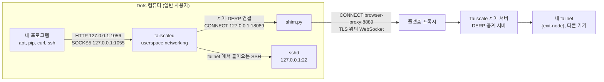

# 동작 원리

[English](how-it-works.md) · 한국어 · [README로 돌아가기](../README.md)

이 문서는 Dots 컴퓨터에서 실제로 무엇이 실행되는지, 각 부분이 왜 필요한지, 네트워크에서 무엇을 기대할 수 있고 무엇은 안 되는지를 설명합니다. 모든 내용은 2026-10-22~23에 실제 Dots 컴퓨터(Debian 13, x86_64, dots-tailscale v0.4.0, Tailscale 1.102.4)에서 확인했습니다. Dots는 Tailscale이 공식으로 안내하는 플랫폼이 아니므로, 보장이 아니라 관찰 결과로 읽어 주세요.

## 짧은 답

- **Dots를 tailnet에 붙이는 공식 방법이 있나요?** 없습니다. OpenAI도 Tailscale도 안내하지 않습니다. 이 구성은 Tailscale을 일반 사용자 권한의 userspace networking 모드로 띄우고, 그 연결을 플랫폼 HTTPS 프록시로 통과시킵니다.
- **tailnet에 접속하려면 exit node가 필요한가요?** 아닙니다. Dots로 SSH 접속하거나 Dots에서 내 다른 기기로 접속하는 데는 필요 없습니다. exit node는 Dots의 인터넷 다운로드를 내 네트워크로 내보내고 싶을 때만 필요합니다.
- **직접 연결(P2P)인가요?** 아닙니다. Dots에서 나가는 UDP가 막혀서 Tailscale이 직접 연결을 만들지 못합니다. 모든 트래픽이 Tailscale의 DERP 중계 서버를 거치고, 연결 하나당 속도는 수백 kB/s 수준입니다.
- **실행 명령에 키가 들어가나요?** 아닙니다. 처음에 `tailscale up`으로 한 번 로그인하고(로그인 URL 또는 auth key 파일), 기기 신원은 상태 디렉터리에 저장됩니다.

## Dots 터미널에서 닿는 곳

| Dots 터미널에서 시험한 것 | 결과 |
|---|---|
| 인터넷으로 바로 HTTPS 연결 | 연결 실패 (curl 종료 코드 7) |
| `http://browser-proxy:8889`를 거친 HTTPS | 동작. 프록시가 이미지가 신뢰하는 CA로 TLS를 풀어서 다시 맺음 |
| Tailscale DERP 28개 지역과 Google로 UDP STUN | 지역마다 세 번씩 보냈지만 응답 없음 |
| Cloudflare로 UDP STUN | 응답 있음 |
| `tailscale netcheck` | `MappingVariesByDestIP: true` |
| tailnet 기기와 `tailscale ping` (양쪽 방향) | 항상 "via DERP", "direct connection not established" |
| sudo, `/usr`·`/etc`·`/var` 쓰기 | 불가 |

목적지에 따라 나가는 UDP를 걸러 내는 것으로 보입니다. 우리가 볼 수 있는 것은 결과뿐이고, 플랫폼의 실제 정책은 알 수 없습니다.

## 구성 요소



| 프로세스 | 듣는 주소 | 역할 |
|---|---|---|
| `tailscaled` | `127.0.0.1:1055`(SOCKS5), `127.0.0.1:1056`(HTTP). 둘 다 dots-tsnet이 켬 | Tailscale 노드. TUN 장치 없이 프로세스 안에 자체 TCP/IP 스택을 둠 |
| `shim.py` | `127.0.0.1:18089` | Tailscale의 제어·DERP 연결이 플랫폼 프록시를 통과하게 함 |
| `sshd` (사용자 권한) | `127.0.0.1:22` | tailnet을 통해 Dots로 SSH 접속 |
| `browser-proxy` (플랫폼) | `browser-proxy:8889` | 인터넷으로 나가는 유일한 길 |

## tailscaled 실행 명령

dots-tailscale v0.4.0이 실행하는 명령에, 마지막 두 프록시 옵션을 dots-tsnet이 더한 것입니다. 키는 들어 있지 않습니다.

```bash
HTTPS_PROXY=http://127.0.0.1:18089 \
HTTP_PROXY=http://127.0.0.1:18089 \
SSL_CERT_FILE=/workspace/.dots-tailscale/shim/bundle.crt \
/workspace/.dots-tailscale/tailscaled \
  --tun=userspace-networking \
  --statedir=/workspace/.dots-tailscale/state \
  --socket=/tmp/dots-tailscale-1000/tailscaled.sock \
  --port=0 \
  --socks5-server=127.0.0.1:1055 \
  --outbound-http-proxy-listen=127.0.0.1:1056
```

각 부분의 역할은 이렇습니다.

- `HTTPS_PROXY`, `HTTP_PROXY`: tailscaled 자신의 HTTPS 연결(제어 서버, DERP, 로그)을 shim으로 보냅니다. 이 값은 tailscaled에만 들어가고 내 셸에는 들어가지 않습니다.
- `SSL_CERT_FILE`: 시스템 CA 목록에 설치할 때 만든 작은 로컬 CA를 더한 파일입니다. shim이 이 로컬 CA로 서명한 인증서를 내밀기 때문에 tailscaled가 믿을 수 있어야 합니다.
- `--tun=userspace-networking`: root도 `/dev/net/tun`도 없으므로 네트워크 스택을 프로세스 안에서 돌립니다.
- `--statedir`: 기기 신원을 VM이 바뀌어도 남는 `/workspace` 아래에 둡니다. 이 디렉터리를 동시에 실행 중인 두 컴퓨터에 복사하면 안 됩니다.
- `--socket`: 제어 소켓을 사용자별 실행 디렉터리에 둡니다(`1000`은 uid).
- `--port=0`: UDP 포트는 아무거나 씁니다. 어차피 Dots에서 UDP가 나가지 못하니 큰 의미는 없습니다.
- `--socks5-server`, `--outbound-http-proxy-listen`: 내 프로그램이 쓸 로컬 프록시입니다(루프백 전용). dots-tailscale 기본값은 꺼짐이고, dots-tsnet이 켭니다.

나머지 두 프로세스는 이렇게 실행됩니다.

```bash
UPSTREAM_HOST=browser-proxy UPSTREAM_PORT=8889 python3 /workspace/.dots-tailscale/shim/shim.py
/usr/sbin/sshd -f /workspace/.dots-tailscale/sshd/sshd_config   # 127.0.0.1:22, 공개키 인증만
```

로그인은 한 번만 하고, 키를 명령줄에 쓰는 일은 없습니다.

```bash
bash /workspace/.dots-tailscale/start.sh login     # "tailscale up --hostname=dots-sandbox --ssh=false" 를 실행하고 로그인 URL 을 보여 줌
DOTS_TS_AUTH_KEY_FILE=/절대/경로/key bash /workspace/.dots-tailscale/start.sh auth   # 또는 파일(권한 600)에서 auth key 를 읽음
```

내 Dots 컴퓨터에서 실제 명령과 환경변수를 보려면 이렇게 합니다.

```bash
pid=$(pgrep -f '^/workspace/.dots-tailscale/tailscaled ')
tr '\0' ' ' < /proc/$pid/cmdline; echo
tr '\0' '\n' < /proc/$pid/environ | grep -E '^(TS_|HTTPS?_PROXY|SSL_CERT_FILE)'
```

`tsnet status`에서도 tailscaled의 PID와 추가로 붙은 `TS_` 환경변수를 볼 수 있습니다.

## Python shim이 하는 일

플랫폼 프록시에는 Tailscale과 맞지 않는 습관이 두 가지 있습니다.

1. **가능하면 HTTP/2를 고릅니다.** 프록시가 TLS를 직접 풀고, 클라이언트가 HTTP/2를 제안하면 그걸 고릅니다. 그런데 Tailscale의 제어 연결(`/ts2021`)과 DERP는 HTTP/1.1의 `Upgrade` 방식에 기대는데, HTTP/2에는 이 방식이 없습니다.
2. **WebSocket 업그레이드만 중계합니다.** 업그레이드 뒤에는 WebSocket일 때만 데이터를 넘겨줍니다. Tailscale은 자체 프로토콜(`Upgrade: tailscale-control-protocol`, `Upgrade: DERP`)로 업그레이드하기 때문에 프록시가 넘겨주지 않습니다.

shim(dots-tailscale의 `shim.py`, Python 표준 라이브러리만 쓰는 약 400줄)은 tailscaled와 플랫폼 프록시 사이에서 이 두 문제를 비켜 갑니다. tailscaled가 연결을 하나 만들 때마다 이렇게 처리합니다.

1. tailscaled가 shim(`127.0.0.1:18089`)에 `CONNECT host:443`을 보냅니다.
2. shim이 같은 `CONNECT`를 `browser-proxy:8889`에 보냅니다.
3. 443 포트라면 shim이 tailscaled와의 TLS를 직접 맺습니다. 이때 로컬 CA로 서명한 그 호스트 이름의 인증서를 쓰고, `http/1.1`만 제안합니다. 인증서는 처음 쓸 때 만들어지며, 예를 들어 `controlplane.tailscale.com`, `log.tailscale.com`, `derp*.tailscale.com`용이 생깁니다.
4. 프록시를 거쳐 진짜 서버와 두 번째 TLS를 맺습니다. 여기서도 `http/1.1`만 제안하고, 시스템 CA로 인증서를 확인합니다.
5. tailscaled의 요청이 WebSocket이 아닌 업그레이드라면, shim이 이를 WebSocket 업그레이드로 바꿔 다시 보냅니다(`Sec-WebSocket-Protocol: tailscale-control-protocol` 또는 `derp`, 제어 핸드셰이크 헤더는 쿼리 파라미터로 옮김). `101` 응답을 RFC 6455대로 검사한 뒤 양쪽을 이어 줍니다. tailscaled가 보낸 바이트는 WebSocket 바이너리 프레임으로, 서버가 보낸 프레임은 다시 원래 바이트로 바꿉니다. Tailscale의 제어 서버와 DERP 서버는 브라우저용 클라이언트를 위해 WebSocket 연결도 받기 때문에 이 방식이 통합니다.
6. 로그 업로드 같은 일반 HTTPS 요청은 HTTP/1.1로 그대로 전달합니다. 443이 아닌 포트의 `CONNECT`는 손대지 않고 넘깁니다.

플랫폼이 볼 수 있는 것: 어떤 Tailscale 서버에 접속하는지와 HTTP 헤더입니다. tailnet 트래픽 내용은 볼 수 없습니다. 제어 통신은 그 연결 안에서 Noise로 암호화되고, DERP는 WireGuard로 암호화된 패킷만 나르기 때문입니다.

dots-tsnet은 shim을 고치지 않습니다. 코드는 [abruption/dots-tailscale의 shim.py](https://github.com/abruption/dots-tailscale/blob/v0.4.0/shim.py)에 있습니다.

## exit node 없이 tailnet에 접속하기

exit node는 인터넷으로 나가는 길에만 관계합니다. Dots와 내 기기 사이의 통신에는 기본 dots-tailscale 구성과, 그 접속을 허용하는 tailnet 정책만 있으면 됩니다.

**Dots로 들어오기.** tailnet의 아무 기기에서 `ssh agent@dots-sandbox`로 접속합니다. 공개키는 `/workspace/.dots-tailscale/sshd/authorized_keys`에 있어야 합니다. userspace 모드의 tailscaled는 tailnet에서 들어온 연결을 로컬 서비스(여기서는 `127.0.0.1:22`)로 넘겨줍니다.

**Dots에서 나가기.** TUN 장치가 없어서 `curl http://100.x.y.z`만으로는 아무 데도 가지 않습니다. 프로그램이 tailscaled를 거쳐야 합니다.

```bash
# HTTP 프록시 (dots-tsnet 이 새 셸에 http_proxy, https_proxy 를 미리 잡아 둠)
curl -x http://127.0.0.1:1056 http://{tailnet-host}:{port}/

# SOCKS5. socks5h 의 "h" 는 이름 해석(MagicDNS 이름 포함)을 tailscaled 에 맡긴다는 뜻
curl --socks5-hostname 127.0.0.1:1055 http://{tailnet-host}:{port}/

# 일반 TCP. 예: 다른 tailnet 기기로 SSH
ssh -F /dev/null -o ProxyCommand="/workspace/.dots-tailscale/dots-ts cli nc %h %p" {user}${tailnet-host}
```

`{tailnet-host}`에는 기기 이름이나 `100.x.y.z` 주소를, `{port}`와 `{user}`에는 내 값을 넣습니다.

exit node를 끈 상태에서 시험했습니다. 두 프록시 모두에서 다른 tailnet 기기의 HTTP 서비스가 `200`으로 응답했고, `tailscale nc`로 그 기기의 SSH 포트에도 연결됐습니다. 인터넷 요청은 예상대로 실패했습니다. exit node가 없으면 tailscaled가 tailnet 밖 주소를 Dots 자체 네트워크로 내보내는데, 그 길이 막혀 있기 때문입니다.

알아 둘 점:

- `-F /dev/null`은 Dots 이미지의 `/etc/ssh/ssh_config.d/20-systemd-ssh-proxy.conf` 권한을 OpenSSH가 거부하기 때문에 붙입니다.
- 다른 기기가 광고하는 서브넷 경로는 기본으로 받지 않습니다(`RouteAll: false`). `/workspace/.dots-tailscale/dots-ts cli set --accept-routes`로 켤 수 있을 것으로 보이지만 시험하지 않았습니다.
- tailnet 정책이 Dots 기기(기본 이름 `dots-sandbox`)에서 그 기기와 포트로의 접속을 허용해야 합니다.
- 태그, grant, 응답 크기 제한까지 갖춘 신중한 예시는 dots-tailscale의 [비공개 HTTP API 연결 예시](https://github.com/abruption/dots-tailscale/blob/main/docs/private-http-api.ko.md)에 있습니다.

## 항상 DERP를 거치는 이유와 속도

Tailscale은 보통 UDP로 WireGuard 직접 연결을 만들고, DERP는 그게 안 될 때만 씁니다. Dots에서는 나가는 UDP가 막혀서(위 표 참고) 그 대안이 유일한 길이 됩니다. 그래서 경로가 깁니다. 내 프로그램, tailscaled, shim, 플랫폼 프록시를 지나는 TLS, DERP 서버, 그리고 `{exit-node}` 순서입니다. Dots 컴퓨터에서 한국에 있는 exit node까지는 도쿄 DERP 서버를 거쳤고 왕복 약 200ms가 걸렸습니다.

2026-10-23에 같은 7MB 파일로 잰 결과입니다.

| 경로 | 속도 |
|---|---|
| `{exit-node}` 경유, 연결 1개 | 270~390kB/s |
| `{exit-node}` 경유, 연결 4개를 동시에 | 약 620kB/s |
| 플랫폼 프록시로 바로 | 약 18MB/s |

도움이 되는 것과 안 되는 것:

- **병렬 다운로드**는 조금 도움이 됩니다(연결 4개로 약 1.6배). 하지만 중계 경로 자체에 상한이 있습니다.
- **`{exit-node}`의 포트 열기**는 도움이 안 됩니다. 패킷이 Dots 밖으로 나가지 못하기 때문입니다.
- **apt만 플랫폼 프록시로 보내기**(`TSNET_APT_PROXY=http://browser-proxy:8889`)는 훨씬 빠릅니다. 대신 어떤 패키지를 받는지 플랫폼이 볼 수 있습니다. 패키지 내용은 apt의 GPG 서명 검사가 계속 지켜 줍니다.
- **DERP 서버 직접 운영**도 결국 같은 프록시를 거쳐 TCP로 접속하게 됩니다. 실제로 나아지는지는 시험하지 않았습니다.

## Tailscale UDP GSO·GRO 설정

Linux에서 처리량이 이상하거나 오류가 보일 때 Tailscale의 UDP 오프로드를 끄는 경우가 있습니다. Dots에서는 어떤 의미인지 정리합니다.

**무엇인가요.** Linux의 GSO(generic segmentation offload)는 프로그램이 UDP 패킷 여러 개를 한 번에 커널에 넘기는 기능이고, GRO(generic receive offload)는 커널이 받은 패킷을 합쳐서 한 번에 올려 주는 기능입니다. Tailscale은 WireGuard 직접 연결에 쓰는 UDP 소켓에서 두 기능을 써서 빠른 속도에서 CPU를 아낍니다. 다음 환경변수로 끌 수 있습니다.

| 환경변수 | 효과 |
|---|---|
| `TS_DEBUG_DISABLE_UDP_GSO=true` | 보낼 때 UDP GSO를 쓰지 않음 |
| `TS_DEBUG_DISABLE_UDP_GRO=true` | 받을 때 UDP GRO를 쓰지 않음 |

두 이름 모두 tailscaled 1.102.4 실행 파일에 들어 있고, 켜면 tailscaled가 시작할 때 로그에 남깁니다(`envknob: TS_DEBUG_DISABLE_UDP_GSO="true"`). 실행 파일에는 `TS_TUN_DISABLE_UDP_GRO`, `TS_TUN_DISABLE_TCP_GRO`도 있는데, 이 둘은 TUN 장치용이라 TUN이 없는 Dots에서는 아무 일도 하지 않습니다.

**Dots에서 의미가 있나요.** 없습니다. 두 설정은 UDP 직접 연결에만 관계하는데, Dots의 트래픽은 전부 TCP 위의 DERP로 지나갑니다. 꺼도 다운로드 속도가 빨라지지도 느려지지도 않습니다. dots-tsnet은 따로 요청하지 않으면 Tailscale 기본값을 그대로 둡니다.

**dots-tailscale 파일을 고치지 않고 끄는 방법.** `/workspace/.tsnet/tsnet.conf`에 적습니다.

```text
TSNET_TAILSCALED_ENV=TS_DEBUG_DISABLE_UDP_GSO=true TS_DEBUG_DISABLE_UDP_GRO=true
```

`tsnet start`와 `install.sh`는 tailscaled를 새로 띄울 때마다(예: VM이 바뀐 뒤) 이 값을 붙입니다. `TS_이름=값` 형식만 받습니다.

**지금 바로 적용하기.** tailscaled가 이미 떠 있으면 `tsnet start`는 그 프로세스를 그대로 쓰고, `tsnet apply`(`dots-ts proxy apply`)는 기존 환경 그대로 다시 띄웁니다. 새 값을 바로 적용하려면 tailscaled를 멈추고 다시 띄워야 합니다. SSH가 끊기므로 Dots 화면의 터미널에서 실행하세요.

```bash
kill "$(pgrep -f '^/workspace/.dots-tailscale/tailscaled ')"
sleep 3
/workspace/.tsnet/bin/tsnet start
```

`tsnet start`가 `socket exists but daemon cannot be identified`로 멈추면, 먼저 `pgrep -f '^/workspace/.dots-tailscale/tailscaled '`가 아무것도 출력하지 않는지 확인합니다. 그다음 남은 소켓을 `rm /tmp/dots-tailscale-$(id -u)/tailscaled.sock`로 지우고 `tsnet start`를 다시 실행합니다. dots-tailscale은 정체를 확인할 수 없는 소켓을 일부러 지우지 않습니다.

**확인하는 방법.** `tsnet status`의 `[tailscaled]` 줄에 나오고, 앞의 실행 명령 절에 있는 `/proc` 명령으로도 볼 수 있습니다.

**`setup.sh`를 직접 고치면 안 되는 이유.** dots-tailscale은 자기 파일의 SHA-256 값을 갖고 있습니다. `/workspace/.dots-tailscale/setup.sh`에 환경변수를 직접 넣으면 `dots-ts version`이 `source integrity: mismatch (modified_or_mixed)`를, `dots-ts doctor`가 `overall: unhealthy`를 보고하고, dots-tailscale의 업데이트 기능도 수정된 설치는 업데이트하지 않습니다. 되돌리려면 원본 파일을 덮어쓰면 됩니다. 원본은 이 저장소의 `upstream/dots-tailscale/tailscale-setup.sh`와 같습니다.

```bash
install -m 700 /workspace/dots-tsnet/upstream/dots-tailscale/tailscale-setup.sh /workspace/.dots-tailscale/setup.sh
/workspace/.dots-tailscale/dots-ts version   # "source integrity: match" 가 나오면 정상
```

## 한계와 주의할 점

- **비공식입니다.** OpenAI도 Tailscale도 지원하지 않습니다. 플랫폼이 바뀌면 언제든 동작하지 않을 수 있습니다.
- **메타데이터는 플랫폼에 보입니다.** Tailscale 서버로 접속한다는 사실은 보이고, tailnet 내용은 암호화된 채로 지나갑니다.
- **exit node가 켜져 있어야 합니다.** `{exit-node}`가 꺼지면 다른 exit node로 바꾸거나 프록시를 끌 때까지 프록시를 거친 다운로드가 실패합니다.
- **VM 하나에 기기 신원 하나.** 같은 상태 디렉터리로 Dots 컴퓨터 두 대를 동시에 돌리면 안 됩니다.
- **셸에서 실행한 프로그램에만 적용됩니다.** 로컬 프록시는 dots-tsnet 환경을 불러온 셸에서 실행한 프로그램에 적용됩니다. Dots 브라우저, ChatGPT 커넥터, Dots 에이전트 자체의 네트워크는 바뀌지 않습니다.
