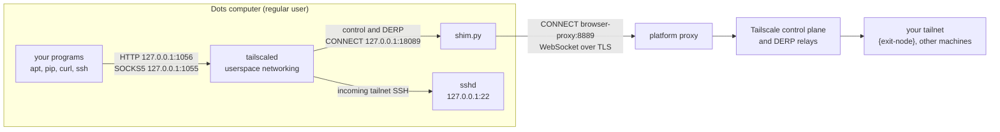

# How it works

English · [한국어](how-it-works.ko.md) · [Back to README](../README.en.md)

This page explains what actually runs on the Dots computer, why each piece is there, and what you can and cannot expect from the network. Everything here was checked on a live Dots computer on 2026-10-22 and 23 (Debian 13, x86_64, dots-tailscale v0.4.0, Tailscale 1.102.4). Dots is not a documented platform for Tailscale, so read this as observations, not guarantees.

## Short answers

- **Is there a supported way to put Dots on a tailnet?** Not an official one. Neither OpenAI nor Tailscale documents it. This setup runs Tailscale as a regular user in userspace-networking mode and tunnels its connections through the platform's HTTPS proxy.
- **Do I need an exit node to reach my tailnet?** No. SSH into Dots and connections from Dots to your other machines work without one. An exit node only matters when you want Dots's internet downloads to leave through your own network.
- **Is the connection direct (peer-to-peer)?** No. Outbound UDP from Dots only seems to pass when the destination port is 3478, and Tailscale peers listen on other ports, so no direct path forms. Everything is relayed through Tailscale's DERP servers, at a few hundred kB/s per connection.
- **Are there keys on the command line?** No. The node logs in once with `tailscale up` (a login URL or an auth key file), and its identity is stored in the state directory.
- **Where does it install?** In `/workspace/shared` (`.dots-tailscale`, `.tsnet`). That folder survives the Dots scratch cleanup that deletes top-level folders under `/workspace`, and the Dots desktop keeps its own user settings there. See [Dots storage and install location](#dots-storage-and-install-location).

## What a Dots terminal can reach

| Test from the Dots terminal | Result |
|---|---|
| HTTPS straight to the internet | Connection fails (curl exit code 7) |
| HTTPS through `http://browser-proxy:8889` | Works. The proxy terminates TLS with a CA that the image trusts |
| STUN (UDP 3478) to all 28 Tailscale DERP regions, formatted like Tailscale's own client | Every region replies |
| Plain STUN requests to the same DERP regions | No reply |
| Google STUN on UDP 3478 and 19302 | Only 3478 replies (three out of three); 19302 does not |
| Cloudflare STUN on UDP 3478, 53 and 443 | Only 3478 replies |
| DNS (UDP 53: 8.8.8.8, 1.1.1.1, 9.9.9.9, OpenDNS) and NTP (UDP 123) | No reply |
| `tailscale netcheck` | `UDP: true`, `MappingVariesByDestIP: true` |
| `tailscale ping` to tailnet machines, in both directions | Always "via DERP", "direct connection not established" |
| sudo, writing to `/usr`, `/etc`, `/var` | Not available |

Outbound UDP seems to pass only when the destination port is 3478. We only tried ports 53, 123, 443, 3478 and 19302, so other ports are unknown. An earlier version of this page said UDP was blocked, because our first plain STUN requests to DERP regions got no reply; resending them in the format Tailscale's client uses got replies from every region. We can only see the effect, not the platform's actual policy.

## The pieces



| Process | Listens on | Role |
|---|---|---|
| `tailscaled` | `127.0.0.1:1055` (SOCKS5), `127.0.0.1:1056` (HTTP), both added by dots-tsnet | The Tailscale node. There is no TUN device; it carries its own TCP/IP stack inside the process |
| `shim.py` | `127.0.0.1:18089` | Lets Tailscale's control and DERP connections pass through the platform proxy |
| `sshd` (user level) | `127.0.0.1:22` | Lets you SSH into Dots over the tailnet. dots-tsnet adds the interactive SSH fix |
| `browser-proxy` (platform) | `browser-proxy:8889` | The only way out to the internet |

## The tailscaled startup command

This is the command dots-tailscale v0.4.0 runs, plus the two proxy flags that dots-tsnet adds at the end. Paths assume the default install location (`/workspace/shared/.dots-tailscale`). There are no keys in it.

```bash
HTTPS_PROXY=http://127.0.0.1:18089 \
HTTP_PROXY=http://127.0.0.1:18089 \
SSL_CERT_FILE=/workspace/shared/.dots-tailscale/shim/bundle.crt \
/workspace/shared/.dots-tailscale/tailscaled \
  --tun=userspace-networking \
  --statedir=/workspace/shared/.dots-tailscale/state \
  --socket=/tmp/dots-tailscale-1000/tailscaled.sock \
  --port=0 \
  --socks5-server=127.0.0.1:1055 \
  --outbound-http-proxy-listen=127.0.0.1:1056
```

What each part is for:

- `HTTPS_PROXY`, `HTTP_PROXY`: send tailscaled's own HTTPS connections (control plane, DERP, logs) to the shim. Only tailscaled gets these values; your shell does not.
- `SSL_CERT_FILE`: the system CA list plus a small local CA created at install time. tailscaled needs it because the shim presents certificates signed by that local CA.
- `--tun=userspace-networking`: there is no root and no `/dev/net/tun`, so Tailscale runs its network stack inside the process.
- `--statedir`: holds the node identity. dots-tsnet keeps it under `/workspace/shared` and also copies the state file to the home directory (`~/.local/state/dots-tsnet`). Never copy this directory to two running machines.
- `--socket`: the control socket lives in a per-user runtime directory (`1000` is the uid).
- `--port=0`: tailscaled picks any local UDP port. Dots appears to filter on the destination port (3478), not the source port, so changing this does not help direct connections.
- `--socks5-server`, `--outbound-http-proxy-listen`: local proxies for your programs, loopback only. dots-tailscale leaves them off by default; dots-tsnet turns them on.

The other two processes:

```bash
UPSTREAM_HOST=browser-proxy UPSTREAM_PORT=8889 python3 /workspace/shared/.dots-tailscale/shim/shim.py
/usr/sbin/sshd -f /workspace/shared/.dots-tailscale/sshd/sshd_config   # 127.0.0.1:22, public keys only
```

`tsnet start` and `install.sh` run dots-tailscale's `start.sh` with the `TS_` values from `TSNET_TAILSCALED_ENV` and with the interactive SSH fix (`LD_PRELOAD=/workspace/shared/.tsnet/lib/pty_chown_shim.so`), so all three processes carry those values in their environment.

Logging in happens once, and no key is ever placed on a command line:

```bash
bash /workspace/shared/.dots-tailscale/start.sh login     # runs "tailscale up --hostname=dots-sandbox --ssh=false" and prints a login URL
DOTS_TS_AUTH_KEY_FILE=/absolute/path/to/key bash /workspace/shared/.dots-tailscale/start.sh auth   # or an auth key read from a file (mode 600)
```

To see the command and environment on your own Dots computer:

```bash
pid=$(pgrep -f "^/workspace/shared/.dots-tailscale/tailscaled ")
tr '\0' ' ' < /proc/$pid/cmdline; echo
tr '\0' '\n' < /proc/$pid/environ | grep -E '^(TS_|HTTPS?_PROXY|SSL_CERT_FILE|LD_PRELOAD)'
```

`tsnet status` also shows tailscaled's PID and any extra `TS_` variables.

## What the Python shim does

The platform proxy has two habits that break Tailscale:

1. **It picks HTTP/2 whenever it can.** The proxy terminates TLS itself and chooses HTTP/2 if the client offers it. Tailscale's control connection (`/ts2021`) and DERP rely on the HTTP/1.1 `Upgrade` mechanism, which HTTP/2 does not have.
2. **It only relays WebSocket upgrades.** After an upgrade, the proxy passes data through only if the upgrade was to WebSocket. Tailscale upgrades to its own protocols (`Upgrade: tailscale-control-protocol` and `Upgrade: DERP`), so the proxy drops them.

The shim (`shim.py` in dots-tailscale, about 400 lines of Python standard library) sits between tailscaled and the platform proxy and works around both. For each connection tailscaled makes:

1. tailscaled sends `CONNECT host:443` to the shim at `127.0.0.1:18089`.
2. The shim sends the same `CONNECT` to `browser-proxy:8889`.
3. For port 443, the shim completes TLS with tailscaled itself, using a certificate for that hostname signed by the local CA, and offers only `http/1.1`. Certificates are created on first use, for example for `controlplane.tailscale.com`, `log.tailscale.com` and `derp*.tailscale.com`.
4. It opens a second TLS session to the real server through the proxy, again offering only `http/1.1`, and verifies it against the system CA store.
5. If tailscaled's request is a non-WebSocket upgrade, the shim re-sends it as a WebSocket upgrade (`Sec-WebSocket-Protocol: tailscale-control-protocol` or `derp`; the control handshake header moves into a query parameter). It checks the `101` response as RFC 6455 requires, then bridges the two sides: raw bytes from tailscaled become WebSocket binary frames, and frames from the server become raw bytes again. Tailscale's control plane and DERP servers also accept WebSocket connections, which their browser client uses, and that is why this works.
6. Ordinary HTTPS requests, such as log uploads, are forwarded as HTTP/1.1. A `CONNECT` to any port other than 443 is passed through unchanged.

What the platform can see: it sees which Tailscale servers you connect to and the HTTP headers. It cannot read your tailnet traffic, because the control protocol is encrypted with Noise inside that connection and DERP only carries WireGuard-encrypted packets.

dots-tsnet does not modify the shim. The source is [shim.py in abruption/dots-tailscale](https://github.com/abruption/dots-tailscale/blob/v0.4.0/shim.py).

## Reaching your tailnet without an exit node

An exit node is only about the internet. For traffic between Dots and your own machines, you need nothing beyond the base dots-tailscale setup and a tailnet policy that allows it.

**Into Dots.** SSH from any device in your tailnet: `ssh agent@dots-sandbox`, with your public key in `/workspace/shared/.dots-tailscale/sshd/authorized_keys`. In userspace mode, tailscaled forwards incoming tailnet connections to local services, here `127.0.0.1:22`.

**Out of Dots.** There is no TUN interface, so `curl http://100.x.y.z` on its own goes nowhere. Programs have to go through tailscaled:

```bash
# HTTP proxy (dots-tsnet already sets http_proxy and https_proxy in new shells)
curl -x http://127.0.0.1:1056 http://{tailnet-host}:{port}/

# SOCKS5; the "h" in socks5h makes tailscaled resolve names, including MagicDNS names
curl --socks5-hostname 127.0.0.1:1055 http://{tailnet-host}:{port}/

# Plain TCP, for example SSH to another tailnet machine
ssh -F /dev/null -o ProxyCommand="/workspace/shared/.dots-tailscale/dots-ts cli nc %h %p" {user}@{tailnet-host}
```

Replace `{tailnet-host}` with a machine name or `100.x.y.z` address, and `{port}` and `{user}` with your own values.

We tested this with the exit node turned off. HTTP requests through both proxies got `200` from another tailnet machine, and `tailscale nc` reached that machine's SSH ports. Internet requests through the proxy failed, as expected: without an exit node, tailscaled sends non-tailnet destinations out through Dots's own network, which is blocked.

Things to know:

- `-F /dev/null` is there because the Dots image ships `/etc/ssh/ssh_config.d/20-systemd-ssh-proxy.conf` with permissions OpenSSH rejects.
- Subnet routes advertised by other machines are not accepted by default (`RouteAll: false`). `/workspace/shared/.dots-tailscale/dots-ts cli set --accept-routes` should enable them; we have not tested it.
- Your tailnet policy must allow the Dots machine (default name `dots-sandbox`) to reach those machines and ports.
- dots-tailscale has a careful [private HTTP API recipe](https://github.com/abruption/dots-tailscale/blob/main/docs/private-http-api.md) with tags, grants and bounded requests.

## Why traffic is always relayed, and how fast it is

Tailscale normally builds a direct WireGuard connection over UDP and uses DERP only as a fallback. On Dots, UDP only seems to get out to destination port 3478, so it cannot reach peers that listen on 41641 or a random port (see the table above). The fallback becomes the only path, and the resulting chain is long: your program, tailscaled, the shim, TLS through the platform proxy, a DERP server, then `{exit-node}`. From a Dots computer to exit nodes in South Korea, traffic went through the Tokyo DERP server with round trips of 190–320 ms.

Measured with the same 7 MB file on 2026-10-23:

| Path | When | Speed |
|---|---|---|
| Through `{exit-node}`, one connection | 3 a.m. | 340–720 kB/s |
| Through `{exit-node}`, one connection | 7–8 p.m. | 90–230 kB/s |
| Through `{exit-node}`, four parallel connections | early morning | about 620 kB/s combined |
| Platform proxy directly | early morning | about 18 MB/s |

Back-to-back downloads with identical settings differed by up to two times (for example 340, 682 and 721 kB/s), and the first download after a tailscaled restart tended to be slow. One or two downloads after changing a setting therefore cannot show whether the setting helped.

What helps, and what does not:

- **Parallel downloads** help a little (about 1.6 times faster with four connections), but the relayed path has a ceiling.
- **Opening Tailscale's usual port (41641) on `{exit-node}`** does not help. Packets from Dots cannot leave toward that port.
- **Making `{exit-node}` listen on UDP 3478** (tailscaled's `--port=3478` plus a port forward on the router) looks like the only way a direct path might form. We have not tested it.
- **Sending only apt through the platform proxy** (`TSNET_APT_PROXY=http://browser-proxy:8889`) is much faster. The platform can then see which packages you download; apt's GPG signature checks still protect package contents.
- **A self-hosted DERP server** would still be reached over TCP through the same proxy. We have not tested whether it improves anything.

## Tailscale UDP GSO/GRO switches

Some people turn off Tailscale's UDP offloads when they see odd throughput or errors on Linux. Here is what they are, when they matter, and what we measured on Dots.

**What they are.** On Linux, GSO (generic segmentation offload) lets a program hand the kernel many UDP packets in one call, and GRO (generic receive offload) lets the kernel merge received packets before handing them up. Tailscale uses both on the UDP socket that carries direct WireGuard traffic, to save CPU at high speeds. Two environment variables turn them off:

| Variable | Effect |
|---|---|
| `TS_DEBUG_DISABLE_UDP_GSO=true` | Do not use UDP GSO when sending |
| `TS_DEBUG_DISABLE_UDP_GRO=true` | Do not use UDP GRO when receiving |

Both names are present in the tailscaled 1.102.4 binary, and tailscaled logs them at startup (`envknob: TS_DEBUG_DISABLE_UDP_GSO="true"`). They are debug switches, so their names or behavior may change. The binary also has `TS_TUN_DISABLE_UDP_GRO` and `TS_TUN_DISABLE_TCP_GRO`, which concern a TUN device. Dots has no TUN device, so those do nothing here.

**When turning them off helps.** Where GSO misbehaves, turning it off is the fix:

- [tailscale#20858](https://github.com/tailscale/tailscale/issues/20858): on a Kubernetes ProxyGroup (`TS_USERSPACE=false`), UDP GSO made a 2.8 MB response crawl at about 20 KiB/s; with `TS_DEBUG_DISABLE_UDP_GSO=true` it ran at about 14–20 MB/s.
- [tailscale#16198](https://github.com/tailscale/tailscale/issues/16198): with TSO/GSO enabled on `tailscale0` in Kubernetes operator proxies, packets are lost and throughput drops; `ethtool -K tailscale0 tso off gso off` restores it.
- [tailscale#19777](https://github.com/tailscale/tailscale/issues/19777): a regression on kernel 7 made uploads in one direction very slow; turning off `tx-udp-segmentation` and GSO on the physical NIC, or booting an older kernel, fixed it.

All three involve direct UDP traffic through a kernel TUN (`tailscale0`) or a physical NIC.

**What we measured on Dots.** On Dots, Tailscale traffic only goes through DERP over TCP: tailscaled's direct-path counter (`direct_ipv4`) stayed at zero bytes for the whole measurement. From 19:34 to 19:50 on 2026-10-23, we alternated the switches off, on and off with the same 7 MB file. Each phase restarted tailscaled, made one warm-up download, then four measured downloads.

| Phase | Setting | Round trip | Four downloads | Average |
|---|---|---|---|---|
| 1 | off | 308 ms | 148, 113, 144, 91 kB/s | 124 kB/s |
| 2 | on (Tailscale default) | 192 ms | 176, 229, 126, 225 kB/s | 189 kB/s |
| 3 | off | 318 ms | 122, 117, 125, 102 kB/s | 117 kB/s |

Turning them off did not make anything faster. The "on" phase was about 1.5 times faster, but its round trip was also about 1.6 times shorter. Over DERP, which runs on TCP, speed roughly follows the round-trip time, and these switches do not touch the DERP path. The difference is best explained by the relay path changing with each restart. Even within one phase, speeds ranged from 91 to 148 kB/s.

**When they could matter on Dots.** If a direct UDP path ever forms (for example with the UDP 3478 approach above), these switches would apply to real traffic. In that case, measure with Tailscale's defaults first and turn them off only if you see a problem.

**How to turn them off without editing dots-tailscale.** Put them in `/workspace/shared/.tsnet/tsnet.conf`:

```text
TSNET_TAILSCALED_ENV=TS_DEBUG_DISABLE_UDP_GSO=true TS_DEBUG_DISABLE_UDP_GRO=true
```

`tsnet start` (and `install.sh`) pass these to tailscaled whenever it is freshly started, for example after a VM replacement. Only `TS_NAME=value` items are accepted.

**Applying them right away.** If tailscaled is already running, `tsnet start` reuses it. To apply new values now, run `tsnet restart`. Over SSH the connection drops for a minute or two, so use `tsnet restart --detach`, then reconnect and check `tsnet status` and `/workspace/shared/.tsnet/restart.log`. `tsnet restart`:

1. stops only this install's tailscaled;
2. waits up to 90 seconds for the proxy ports to free up, because dots-tailscale refuses to start with "occupied port" while connections of the old daemon are still in TIME_WAIT;
3. tries to start up to three times and checks that real traffic passes through the proxy;
4. on failure, starts again with the `TS_` settings the previous daemon had.

**How to check.** `tsnet status` prints them on the `[tailscaled]` line, and the `/proc` command from the startup section shows them as well.

**Edited `setup.sh` by hand?** dots-tailscale keeps SHA-256 values for its own files. If you add the variables to `/workspace/shared/.dots-tailscale/setup.sh` directly, `dots-ts version` reports `source integrity: mismatch (modified_or_mixed)`, `dots-ts doctor` reports `overall: unhealthy`, and dots-tailscale's updater refuses to update a modified install. `tsnet doctor --fix` moves the `TS_` settings you added into `TSNET_TAILSCALED_ENV` in `tsnet.conf` and restores the original `setup.sh`, checked against the install record's SHA-256. Your edited file is kept in `/workspace/shared/.tsnet/backup/`, and the running tailscaled is not restarted.

## Dots storage and install location

Up to 0.1.1, dots-tsnet followed dots-tailscale's default and installed directly under `/workspace`, and 0.1.2 installed into the home directory. After a closer look at how Dots storage is laid out, it installs into `/workspace/shared` from 0.1.3 on.

**How Dots storage is laid out.** The Dots desktop and terminals run inside a bubblewrap sandbox with every capability dropped. `/workspace` and the home directory are both bound from the same disk (an overlay); the home directory is that disk's `/home/agent/.local/share/orbit-native` mounted at `/home/agent`. The root (`/`) and `/tmp` live in memory (tmpfs) and vanish with the VM. Under `/workspace` sit the Dots task folders (`scratch/<task id>`) and `shared`, and the Dots documentation tells agents to keep task files in `/workspace/scratch/<task-directory>`.

**What happened.** At 06:49:37 (Korea time) on 2026-10-23, the Dots scratch cleanup deleted several top-level folders under `/workspace`. The VM had been up since 16:19 the day before and was not rebooted.

- In the same second, `/workspace/.scratch-cleaning/92af8521d3e5` (containing the single line `v1`), `/workspace/shared` and `/workspace/shared/.orbit-os` were created. `92af8521d3e5` matches the name of the Dots task folder under `/workspace/scratch/`.
- Deleted: `/workspace/.tsnet`, `/workspace/.dots-tailscale` and `/workspace/dots-tsnet` (a clone of this repository). A Chrome process that kept running showed its executable as `/workspace/.scratch-cleaning-<hash>-<number>-<random>/root/opt/google/chrome/chrome (deleted)`, so the folder appears to have been renamed and then removed.
- Kept: a regular `.deb` file in the same place, `scratch` (with task files going back to early October), the image's own `.agents`, `.codex` and `.git`, and the whole home directory.
- Afterwards: tailscaled, the shim, sshd and Chrome kept running from deleted files. About 11 hours later, Chrome and apt started failing with proxy errors: DNS lookups through the exit node timed out with HTTP 500, and connections straight to IP addresses timed out too. New connections apparently could not be set up from deleted files.
- The Tailscale state file was deleted as well, so the machine could not come back with the same identity and had to be registered as a new machine.

**Why `/workspace/shared`?**

- The cleanup created it instead of deleting it.
- The Dots desktop configuration `/etc/orbit-os/config.toml` says "User overrides persist in /workspace/shared/.orbit-os/dock.toml" and points its theme data directory at `/workspace/shared/.orbit-os/cache/xdg`. Dots keeps data it means to persist there.
- The home directory survived this cleanup too, but every file in it was created after the VM booted at 16:19 on 2026-10-22. Unlike `/workspace/scratch`, which holds files from early October, nothing shows that the home directory outlives a VM replacement.

Nothing public says what the cleanup removes or how often it runs, and there is no official promise that `/workspace/shared` persists either.

**When the whole environment goes back.** Separately from the cleanup, several people report their Dots environment going back to an older snapshot: recent work disappeared while older files remained ([openai/codex#52765](https://github.com/openai/codex/issues/52765)). Then `/workspace` and the home directory can go back together. Those reporters recovered from backups kept outside Dots (the ChatGPT Library, Google Drive). The Dots sandbox has no `/dev/fuse`, every capability is zero and privilege escalation is blocked (`NoNewPrivs=1`), so Google Drive cannot be mounted. Running the image's rclone as `rclone copy --update` on a schedule gives a backup that never deletes anything on Drive and never overwrites a newer file there.

**What dots-tsnet does about it.**

- **It installs into `/workspace/shared`.** dots-tailscale goes to `/workspace/shared/.dots-tailscale` and dots-tsnet, including installed packages, to `/workspace/shared/.tsnet`. Without `/workspace/shared`, it installs into the home directory.
- **It keeps a backup on the other side.** The node identity (Tailscale state file), the SSH host key, `authorized_keys`, `tsnet.conf` and the list of installed packages are copied to `~/.local/state/dots-tsnet` in the home directory (mode 700, files 600), or to `/workspace/shared/.dots-tsnet-backup` for a home-directory install. Changed files are copied at every new shell, `tsnet start` and `tsnet status`. It contains private keys; never move it to another machine.
- **It clears out processes left running from deleted files.** If tailscaled runs from a deleted executable, `tsnet start` and `install.sh` stop it together with the shim and sshd listener of the same install, remove that daemon's socket, and start fresh. Inside an SSH session they do not stop anything, since that would cut the connection; they ask you to run from the Dots desktop terminal instead.
- **A reinstall restores from the backup.** Missing dots-tailscale files are filled in with the same version, and the node identity, SSH host key and settings come back from the backup. If the current backup location has nothing, the locations older versions used (such as `/workspace/.dots-tsnet-backup`) are checked too. Without any backup it stops, like dots-tailscale does, and logs in as a new machine only when you pass `--new-identity`.
- **Older installs are moved.** If an install exists in the home directory (0.1.2) or under `/workspace` (0.1.1 or earlier), `install.sh` moves it into `/workspace/shared`: it copies the binaries, SSH keys, proxy settings and packages, stops the old tailscaled, shim and sshd, copies the state file, waits for the ports, and starts in the new place with the same identity. On failure it goes back to the old install; on success it removes the old location and the old backup location (`/workspace/.dots-tsnet-backup`) and fixes desktop launchers (`~/.local/share/applications/*.desktop`) that pointed at it. On 2026-10-23 a live Dots computer was moved from `/workspace` to the home directory in the evening and from the home directory to `/workspace/shared` later that night, keeping its machine name and exit node setting both times.

## Interactive SSH (PTY) fix

**The problem.** On a Dots computer, `/dev/pts` entries are created with the user's group (gid 1000), while the system also has a `tty` group (gid 5). When OpenSSH's sshd opens a PTY, it calls `chown` to give the device to the `tty` group; as a non-root user it fails and drops the session. A terminal app shows `Connection to ... closed by remote host`, while `ssh -T` and one-off commands (`ssh host command`), which use no PTY, work.

**The fix.** `lib/pty_chown_shim.c` is a tiny library that reports success for `chown` on paths under `/dev/pts/` and passes every other call to the real function. `install.sh` compiles it with the C compiler (`cc`) into `/workspace/shared/.tsnet/lib/pty_chown_shim.so`, and `tsnet start` and `install.sh` attach it with `LD_PRELOAD` when they run dots-tailscale's `start.sh`.

- It applies to the sshd listener and to the sshd session process started for each connection. sshd builds a fresh environment for login shells, so your shell does not inherit it.
- tailscaled and the Python shim also see it in their environment, but they never `chown` `/dev/pts` paths, so nothing changes for them.
- If an sshd listener is running without the fix, `tsnet start` stops just the listener and starts it again with the fix. Open SSH sessions are separate processes and stay connected.
- To check, run `ssh -tt agent@{Dots machine} tty` from your computer; it should print `/dev/pts/<number>`.
- To turn it off, set `TSNET_SSH_PTY_FIX=0` in `tsnet.conf`. Without a C compiler, the installer skips the fix and says so.

dots-tailscale's own files are not modified.

## Limits and caveats

- **Unofficial.** Nothing here is supported by OpenAI or Tailscale. A platform change can break it at any time.
- **Metadata is visible to the platform.** The platform can see connections to Tailscale's servers. Tailnet contents stay encrypted.
- **Exit node availability.** If `{exit-node}` goes offline, downloads through the proxy fail until you switch exit nodes or turn the proxy off.
- **One node identity per VM.** Do not run two Dots computers from the same state file, and never copy the backup folder to another machine.
- **The cleanup rules are unknown.** Dots uses `/workspace/shared` for data it keeps, but no official document promises that, and whole environments have gone back to older snapshots. That is why the backup lives on the other side, and why work products deserve a copy outside Dots.
- **Shell programs only.** The local proxies affect programs started from a shell that loaded the dots-tsnet environment. The Dots browser, ChatGPT connectors and the Dots agent itself are not affected. A browser installed with tsapt and started from such a shell does use the proxy.
