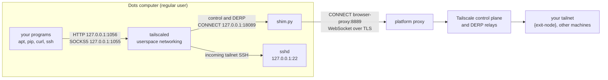

# How it works

English · [한국어](how-it-works.ko.md) · [Back to README](../README.en.md)

This page explains what actually runs on the Dots computer, why each piece is there, and what you can and cannot expect from the network. Everything here was checked on a live Dots computer on 2026-10-22 and 23 (Debian 13, x86_64, dots-tailscale v0.4.0, Tailscale 1.102.4). Dots is not a documented platform for Tailscale, so read this as observations, not guarantees.

## Short answers

- **Is there a supported way to put Dots on a tailnet?** Not an official one. Neither OpenAI nor Tailscale documents it. This setup runs Tailscale as a regular user in userspace-networking mode and tunnels its connections through the platform's HTTPS proxy.
- **Do I need an exit node to reach my tailnet?** No. SSH into Dots and connections from Dots to your other machines work without one. An exit node only matters when you want Dots's internet downloads to leave through your own network.
- **Is the connection direct (peer-to-peer)?** No. Outbound UDP from Dots is filtered, so Tailscale never builds a direct path. Everything is relayed through Tailscale's DERP servers, which caps speed at a few hundred kB/s per connection.
- **Are there keys on the command line?** No. The node logs in once with `tailscale up` (a login URL or an auth key file), and its identity is stored in the state directory.

## What a Dots terminal can reach

| Test from the Dots terminal | Result |
|---|---|
| HTTPS straight to the internet | Connection fails (curl exit code 7) |
| HTTPS through `http://browser-proxy:8889` | Works. The proxy terminates TLS with a CA that the image trusts |
| UDP STUN to all 28 Tailscale DERP regions and to Google | No reply, three tries each |
| UDP STUN to Cloudflare | Replies |
| `tailscale netcheck` | `MappingVariesByDestIP: true` |
| `tailscale ping` to tailnet machines, in both directions | Always "via DERP", "direct connection not established" |
| sudo, writing to `/usr`, `/etc`, `/var` | Not available |

The pattern suggests that outbound UDP is filtered by destination. We can only see the effect, not the platform's actual policy.

## The pieces



| Process | Listens on | Role |
|---|---|---|
| `tailscaled` | `127.0.0.1:1055` (SOCKS5), `127.0.0.1:1056` (HTTP), both added by dots-tsnet | The Tailscale node. There is no TUN device; it carries its own TCP/IP stack inside the process |
| `shim.py` | `127.0.0.1:18089` | Lets Tailscale's control and DERP connections pass through the platform proxy |
| `sshd` (user level) | `127.0.0.1:22` | Lets you SSH into Dots over the tailnet |
| `browser-proxy` (platform) | `browser-proxy:8889` | The only way out to the internet |

## The tailscaled startup command

This is the command dots-tailscale v0.4.0 runs, plus the two proxy flags that dots-tsnet adds at the end. There are no keys in it.

```bash
HTTPS_PROXY=http://127.0.0.1:18089 \
HTTP_PROXY=http://127.0.0.1:18089 \
SSL_CERT_FILE=/workspace/.dots-tailscale/shim/bundle.crt \
/workspace/.dots-tailscale/tailscaled \
  --tun=userspace-networking \
  --statedir=/workspace/.dots-tailscale/state \
  --socket=/tmp/dots-tailscale-1000/tailscaled.sock \
  --port=0 \
  --socks5-server=127.0.0.1:1055 \
  --outbound-http-proxy-listen=127.0.0.1:1056
```

What each part is for:

- `HTTPS_PROXY`, `HTTP_PROXY`: send tailscaled's own HTTPS connections (control plane, DERP, logs) to the shim. Only tailscaled gets these values; your shell does not.
- `SSL_CERT_FILE`: the system CA list plus a small local CA created at install time. tailscaled needs it because the shim presents certificates signed by that local CA.
- `--tun=userspace-networking`: there is no root and no `/dev/net/tun`, so Tailscale runs its network stack inside the process.
- `--statedir`: keeps the node identity under `/workspace`, which survives VM replacement. Never copy this directory to two running machines.
- `--socket`: the control socket lives in a per-user runtime directory (`1000` is the uid).
- `--port=0`: any UDP port. It hardly matters, since UDP cannot leave Dots anyway.
- `--socks5-server`, `--outbound-http-proxy-listen`: local proxies for your programs, loopback only. dots-tailscale leaves them off by default; dots-tsnet turns them on.

The other two processes:

```bash
UPSTREAM_HOST=browser-proxy UPSTREAM_PORT=8889 python3 /workspace/.dots-tailscale/shim/shim.py
/usr/sbin/sshd -f /workspace/.dots-tailscale/sshd/sshd_config   # 127.0.0.1:22, public keys only
```

Logging in happens once, and no key is ever placed on a command line:

```bash
bash /workspace/.dots-tailscale/start.sh login     # runs "tailscale up --hostname=dots-sandbox --ssh=false" and prints a login URL
DOTS_TS_AUTH_KEY_FILE=/absolute/path/to/key bash /workspace/.dots-tailscale/start.sh auth   # or an auth key read from a file (mode 600)
```

To see the command and environment on your own Dots computer:

```bash
pid=$(pgrep -f '^/workspace/.dots-tailscale/tailscaled ')
tr '\0' ' ' < /proc/$pid/cmdline; echo
tr '\0' '\n' < /proc/$pid/environ | grep -E '^(TS_|HTTPS?_PROXY|SSL_CERT_FILE)'
```

`tsnet status` also shows tailscaled's PID and any extra `TS_` variables.

## What the Python shim does

The platform proxy has two habits that break Tailscale:

1. **It picks HTTP/2 whenever it can.** The proxy terminates TLS itself and chooses HTTP/2 if the client offers it. Tailscale's control connection (`/ts2021`) and DERP rely on the HTTP/1.1 `Upgrade` mechanism, which HTTP/2 does not have.
2. **It only relays WebSocket upgrades.** After an upgrade, the proxy passes data through only if the upgrade was to WebSocket. Tailscale upgrades to its own protocols (`Upgrade: tailscale-control-protocol` and `Upgrade: DERP`), so the proxy drops them.

The shim (`shim.py` in dots-tailscale, about 400 lines of Python standard library) sits between tailscaled and the platform proxy and works around both. For each connection tailscaled makes:

1. tailscaled sends `CONNECT host:443` to the shim at `127.0.0.1:18089`.
2. The shim sends the same `CONNECT` to `browser-proxy:8889`.
3. For port 443, the shim completes TLS with tailscaled itself, using a certificate for that hostname signed by the local CA, and offers only `http/1.1`. Certificates are created on first use, for example for `controlplane.tailscale.com`, `log.tailscale.com` and `derp*.tailscale.com`.
4. It opens a second TLS session to the real server through the proxy, again offering only `http/1.1`, and verifies it against the system CA store.
5. If tailscaled's request is a non-WebSocket upgrade, the shim re-sends it as a WebSocket upgrade (`Sec-WebSocket-Protocol: tailscale-control-protocol` or `derp`; the control handshake header moves into a query parameter). It checks the `101` response as RFC 6455 requires, then bridges the two sides: raw bytes from tailscaled become WebSocket binary frames, and frames from the server become raw bytes again. Tailscale's control plane and DERP servers also accept WebSocket connections, which their browser client uses, and that is why this works.
6. Ordinary HTTPS requests, such as log uploads, are forwarded as HTTP/1.1. A `CONNECT` to any port other than 443 is passed through unchanged.

What the platform can see: it sees which Tailscale servers you connect to and the HTTP headers. It cannot read your tailnet traffic, because the control protocol is encrypted with Noise inside that connection and DERP only carries WireGuard-encrypted packets.

dots-tsnet does not modify the shim. The source is [shim.py in abruption/dots-tailscale](https://github.com/abruption/dots-tailscale/blob/v0.4.0/shim.py).

## Reaching your tailnet without an exit node

An exit node is only about the internet. For traffic between Dots and your own machines, you need nothing beyond the base dots-tailscale setup and a tailnet policy that allows it.

**Into Dots.** SSH from any device in your tailnet: `ssh agent@dots-sandbox`, with your public key in `/workspace/.dots-tailscale/sshd/authorized_keys`. In userspace mode, tailscaled forwards incoming tailnet connections to local services, here `127.0.0.1:22`.

**Out of Dots.** There is no TUN interface, so `curl http://100.x.y.z` on its own goes nowhere. Programs have to go through tailscaled:

```bash
# HTTP proxy (dots-tsnet already sets http_proxy and https_proxy in new shells)
curl -x http://127.0.0.1:1056 http://{tailnet-host}:{port}/

# SOCKS5; the "h" in socks5h makes tailscaled resolve names, including MagicDNS names
curl --socks5-hostname 127.0.0.1:1055 http://{tailnet-host}:{port}/

# Plain TCP, for example SSH to another tailnet machine
ssh -F /dev/null -o ProxyCommand="/workspace/.dots-tailscale/dots-ts cli nc %h %p" {user}${tailnet-host}
```

Replace `{tailnet-host}` with a machine name or `100.x.y.z` address, and `{port}` and `{user}` with your own values.

We tested this with the exit node turned off. HTTP requests through both proxies got `200` from another tailnet machine, and `tailscale nc` reached that machine's SSH ports. Internet requests through the proxy failed, as expected: without an exit node, tailscaled sends non-tailnet destinations out through Dots's own network, which is blocked.

Things to know:

- `-F /dev/null` is there because the Dots image ships `/etc/ssh/ssh_config.d/20-systemd-ssh-proxy.conf` with permissions OpenSSH rejects.
- Subnet routes advertised by other machines are not accepted by default (`RouteAll: false`). `/workspace/.dots-tailscale/dots-ts cli set --accept-routes` should enable them; we have not tested it.
- Your tailnet policy must allow the Dots machine (default name `dots-sandbox`) to reach those machines and ports.
- dots-tailscale has a careful [private HTTP API recipe](https://github.com/abruption/dots-tailscale/blob/main/docs/private-http-api.md) with tags, grants and bounded requests.

## Why traffic is always relayed, and how fast it is

Tailscale normally builds a direct WireGuard connection over UDP and uses DERP only as a fallback. On Dots the fallback becomes the only path, because outbound UDP is filtered (see the table above). The resulting chain is long: your program, tailscaled, the shim, TLS through the platform proxy, a DERP server, then `{exit-node}`. From a Dots computer to exit nodes in South Korea, round trips went through the Tokyo DERP server and took about 200 ms.

Measured with the same 7 MB file on 2026-10-23:

| Path | Speed |
|---|---|
| Through `{exit-node}`, one connection | 270–390 kB/s |
| Through `{exit-node}`, four parallel connections | about 620 kB/s |
| Platform proxy directly | about 18 MB/s |

What helps, and what does not:

- **Parallel downloads** help a little (about 1.6 times faster with four connections), but the relayed path has a ceiling.
- **Opening ports on `{exit-node}`** does not help. The packets never leave Dots.
- **Sending only apt through the platform proxy** (`TSNET_APT_PROXY=http://browser-proxy:8889`) is much faster. The platform can then see which packages you download; apt's GPG signature checks still protect package contents.
- **A self-hosted DERP server** would still be reached over TCP through the same proxy. We have not tested whether it improves anything.

## Tailscale UDP GSO/GRO switches

Some people turn off Tailscale's UDP offloads when they see odd throughput or errors on Linux. Here is what that means on Dots.

**What they are.** On Linux, GSO (generic segmentation offload) lets a program hand the kernel many UDP packets in one call, and GRO (generic receive offload) lets the kernel merge received packets before handing them up. Tailscale uses both on the UDP socket that carries direct WireGuard traffic, to save CPU at high speeds. Two environment variables turn them off:

| Variable | Effect |
|---|---|
| `TS_DEBUG_DISABLE_UDP_GSO=true` | Do not use UDP GSO when sending |
| `TS_DEBUG_DISABLE_UDP_GRO=true` | Do not use UDP GRO when receiving |

Both names are present in the tailscaled 1.102.4 binary, and tailscaled logs them at startup (`envknob: TS_DEBUG_DISABLE_UDP_GSO="true"`). The binary also has `TS_TUN_DISABLE_UDP_GRO` and `TS_TUN_DISABLE_TCP_GRO`, which concern a TUN device. Dots has no TUN device, so those do nothing here.

**Do they matter on Dots?** No. They only affect direct UDP paths, and on Dots all traffic goes through DERP over TCP. Turning them off neither helps nor hurts download speed. dots-tsnet leaves them at Tailscale's defaults unless you ask otherwise.

**How to turn them off without editing dots-tailscale.** Put them in `/workspace/.tsnet/tsnet.conf`:

```text
TSNET_TAILSCALED_ENV=TS_DEBUG_DISABLE_UDP_GSO=true TS_DEBUG_DISABLE_UDP_GRO=true
```

`tsnet start` (and `install.sh`) pass these to tailscaled whenever it is freshly started, for example after a VM replacement. Only `TS_NAME=value` items are accepted.

**Applying them right away.** If tailscaled is already running, `tsnet start` reuses it, and `tsnet apply` (or `dots-ts proxy apply`) restarts it with the same environment it already had. To apply new values now, stop tailscaled and start it again. Do this from the Dots desktop terminal, because SSH drops:

```bash
kill "$(pgrep -f '^/workspace/.dots-tailscale/tailscaled ')"
sleep 3
/workspace/.tsnet/bin/tsnet start
```

If `tsnet start` stops with `socket exists but daemon cannot be identified`, first make sure `pgrep -f '^/workspace/.dots-tailscale/tailscaled '` prints nothing, then remove the leftover socket with `rm /tmp/dots-tailscale-$(id -u)/tailscaled.sock` and run `tsnet start` again. dots-tailscale deliberately refuses to delete a socket it cannot identify.

**How to check.** `tsnet status` prints them on the `[tailscaled]` line, and the `/proc` command from the startup section shows them as well.

**Why not edit `setup.sh`?** dots-tailscale keeps SHA-256 values for its own files. If you add the variables to `/workspace/.dots-tailscale/setup.sh` by hand, `dots-ts version` reports `source integrity: mismatch (modified_or_mixed)`, `dots-ts doctor` reports `overall: unhealthy`, and dots-tailscale's updater refuses to update a modified install. To go back, copy the original file over it. The original is identical to `upstream/dots-tailscale/tailscale-setup.sh` in this repository.

```bash
install -m 700 /workspace/dots-tsnet/upstream/dots-tailscale/tailscale-setup.sh /workspace/.dots-tailscale/setup.sh
/workspace/.dots-tailscale/dots-ts version   # should report "source integrity: match"
```

## Limits and caveats

- **Unofficial.** Nothing here is supported by OpenAI or Tailscale. A platform change can break it at any time.
- **Metadata is visible to the platform.** The platform can see connections to Tailscale's servers. Tailnet contents stay encrypted.
- **Exit node availability.** If `{exit-node}` goes offline, downloads through the proxy fail until you switch exit nodes or turn the proxy off.
- **One node identity per VM.** Do not run two Dots computers from the same state directory.
- **Shell programs only.** The local proxies affect programs started from a shell that loaded the dots-tsnet environment. The Dots browser, ChatGPT connectors and the Dots agent itself are not affected.
